# “白狼”的两种声音 

# “静心阅读”与“即时沉浸”：从受众视阈透视《猎魔人》文学译本与《巫师3》游戏文本的语用及修辞分流

**A Comparative Corpus and Pragmatic Study on the Chinese Translation of *The Witcher* Novels and *The Witcher 3: Wild Hunt* Game Localization: Literary Contemplation vs. Interactive Immersion**

---

## 摘要 (Abstract)

在跨媒介叙事与文学改编研究中，关于《巫师3：狂猎》（*The Witcher 3: Wild Hunt*）与其文学母本《猎魔人》（*Wiedźmin*）的讨论多集中于剧情结构重构与世界观承袭，而在语言本体、修辞策略及微观用词层面的实证对比长期缺位。基于国内通行的重庆出版社官方简体中文全译本（约 156.9 万字）与 CD PROJEKT RED 官方解包全量剧情文本（其中剧情台词约 155.2 万字），本研究构建了规模接近 1:1 的大型对称双向对比语料库。

结合计算语言学量化指标（平均句长、标点分布、词汇密度与特定词目相对频次）与微观语用学案例细读，本研究系统揭示了两者在语言思路上的根本分流：小说译本定位于满足文学读者的**“静心深度阅读”**，语法上保留欧化复合句式与缓慢的行文节奏，修辞上重在展现哲学思辨、多重视角与委婉讽刺，词汇体现出对“命运”、“理性”等形而上概念的高频关照；而游戏官方文本则全面锚定交互玩家的**“即时具身沉浸”**，受到多模态认知负荷控制、游戏交互倒计时及配音演播（Voice Acting）的严格物理制约，台词大幅趋于短促精炼、疑问与祈使言语行为显著激增，市井詈语（脏话）、方言口语与契约用词呈现爆发式增长。研究进一步从媒介可供性（Media Affordance）、接受美学与翻译目的论（Skopos Theory）深入阐释了两类文本在受众心智模型、交互功能与跨媒介创译（Transcreation）中的深层机理，为当代数字互动娱乐与经典文学双向转化的本地化实践提供了实证支撑。

**关键词**：《猎魔人》；《巫师3：狂猎》；语料库语言学；游戏本地化；媒介可供性；言语行为；受众接受

---

## Abstract

In the field of transmedia storytelling and adaptation studies, comparative analyses between the video game *The Witcher 3: Wild Hunt* and its literary foundation, Andrzej Sapkowski's *The Witcher* saga (*Wiedźmin*), have largely remained confined to plot divergences and world-building mechanics, leaving linguistic choices and pragmatic register shifts under-explored. Utilizing the complete official Simplified Chinese literary translation (Chongqing Publishing House, approx. 1.57 million characters) and the extracted official localization corpus of *The Witcher 3* (dialogue corpus approx. 1.55 million characters), this study constructs a 1:1 scale parallel comparative corpus.

Integrating computational corpus metrics (average sentence length, punctuation distributions, type-token ratio, relative frequency of stylistic markers) with pragmatic case studies, this paper illustrates the divergent linguistic paradigms tailored for distinct audiences. The literary translation caters to the "contemplative, deep-reading" literary audience by maintaining Europeanized compound syntax, deliberate pacing, philosophical existentialism, and nuanced irony, prominently featuring metaphysical keywords such as "fate" and "reason." Conversely, the video game localization is structurally governed by the demands of "real-time interactive immersion." Constrained by multimodal cognitive load limits (subtitles, audio, HUD navigation, and timed dialogue wheels), the game dialogue exhibits distinct syntactic compression, a marked surge in imperative and interrogative speech acts, and an influx of earthy vernacular curses and contractual terminology. Framed through media affordance, reception theory, and translation skopos theory, this study uncovers the communicative mechanics between passive readers and active agency-driven players, offering empirical insights for transmedia localization and narrative design.

**Keywords**: *The Witcher*; *The Witcher 3: Wild Hunt*; Corpus Linguistics; Game Localization; Media Affordance; Speech Acts; Audience Reception

---

## 目录 (Table of Contents)

- [一、 引言：跨媒介改编中的“语言失焦”与受众预设](#一-引言跨媒介改编中的语言失焦与受众预设)
- [二、 语料构建与量化计算方法](#二-语料构建与量化计算方法)
- [三、 宏观量化图景：句法节奏、标点修辞与词汇计量](#三-宏观量化图景句法节奏标点修辞与词汇计量)
  - [3.1 句长分布与呼吸节奏：从延宕沉思到瞬时截断](#31-句长分布与呼吸节奏从延宕沉思到瞬时截断)
  - [3.2 标点修辞与言语行为倾向：疑问、惊叹与语流停顿](#32-标点修辞与言语行为倾向疑问惊叹与语流停顿)
  - [3.3 词汇多样性与核心意象分野：“命运形而上”与“交互指令集”](#33-词汇多样性与核心意象分野命运形而上与交互指令集)
- [四、 微观质性细读：三维典型语用场域对比](#四-微观质性细读三维典型语用场域对比)
  - [4.1 杰洛特的双重面相：存在主义漫游者 vs 实用主义冷面佣兵](#41-杰洛特的双重面相存在主义漫游者-vs-实用主义冷面佣兵)
  - [4.2 詈语与市井乡谈的本地化分流：文学“欧化雅驯” vs 游戏“泥土草莽”](#42-詈语与市井乡谈的本地化分流文学欧化雅驯-vs-游戏泥土草莽)
  - [4.3 叙事机制的双重重塑：丹德里恩传奇纪实 vs 界面行动导航](#43-叙事机制的双重重塑丹德里恩传奇纪实-vs-界面行动导航)
  - [4.4 隐秘的缓冲地带：游戏文献（Books & Letters）对文学传统的生态补偿](#44-隐秘的缓冲地带游戏文献books--letters对文学传统的生态补偿)
- [五、 传媒生态与翻译伦理的深层机理归因](#五-传媒生态与翻译伦理的深层机理归因)
  - [5.1 媒介可供性（Affordance）与多模态认知负荷控制（15字/秒生理红线）](#51-媒介可供性affordance与多模态认知负荷控制15字秒生理红线)
  - [5.2 受众身份转换：旁观解释者（Reader）与具身决策者（Player）的心理契约](#52-受众身份转换旁观解释者reader与具身决策者player的心理契约)
  - [5.3 翻译目的论（Skopos Theory）与“创译”（Transcreation）的实践边界](#53-翻译目的论skopos-theory与创译transcreation的实践边界)
- [六、 结语与跨媒介叙事启示](#六-结语与跨媒介叙事启示)
- [参考文献 (References)](#参考文献-references)

---

## 一、 引言：跨媒介改编中的“语言失焦”与受众预设

由波兰作家安杰伊·萨普科夫斯基（Andrzej Sapkowski）创作的奇幻文学史诗《猎魔人》（*Wiedźmin*），与 CD PROJEKT RED 制作发行的开放世界角色扮演游戏《巫师3：狂猎》（*The Witcher 3: Wild Hunt*），共同构成了当代全球流行文化中跨媒介衍生最成功的范例之一。然而，在现有文艺批评与泛文化研讨中，评论者往往热衷于探讨两者在人物命运改编、原著剧情续写、世界观地理拓展等宏观叙事层面的分歧，却极少有人深入考察两套媒介系统在**微观语言学（Linguistic）与语用学（Pragmatic）**层面的深层差异——即这两部作品究竟是如何通过“不同的句子、不同的字词、不同的节奏”与受众说话的。

探讨这一差异的客观前提，是明确其所面向的两组截然不同的**“隐含受众”（Implied Audience）**：
1. **小说的受众是“深度阅读的读者”**：阅读是单通道视觉驱动的心智活动。读者掌控着绝对的时空支配权，可以随时掩卷深思、回溯跳读、咀嚼潜台词与多义隐喻。文学译者面对的是习惯于静心审美、愿意探究人物道德困境与哲学博弈的严肃受众。
2. **游戏的受众是“多任务操作的玩家”**：游戏是视听交互与机能操控交织的多模态复合场域。玩家的手指操纵着输入设备，双眼在三维立体场景、敌对单位、动作判定、小地图指示与底部字幕之间高频切换，耳朵倾听环境声效与人物语音，甚至需要在限定倒计时（Timed Decision Wheel）内做出决定生死走向的选择。此时，文本的首要职能是**高效率、低歧义、即时传达**。

由于中文学界多受限于波兰语原文的解读门槛，本研究选择立足于最广大受众所能接触到的成熟汉语语料：国内公认最具代表性的**重庆出版社官方全套小说中文译本**，以及由开发团队自主解包导出的**《巫师3：狂猎》官方简体中文本地化语料**。通过计算语言学量化统计与典型案例对齐细读，全面剖析二者在语言策略上的分流逻辑。

---

## 二、 语料构建与量化计算方法

为了规避以往定性文学批评中“以偏概全”、“个案偶发”的局限性，本研究首先搭建了具有统计严密性的大型对照语料库：

1. **小说语料库（Novel Corpus）**：
   - 文本来源：安杰伊·萨普科夫斯基著《猎魔人修订版全集》（卷一至卷七，含短篇集《白狼崛起》、《命运之剑》及长篇五部曲《精灵之血》、《轻蔑时代》、《火之洗礼》、《雨燕之塔》、《湖中女士》）。
   - 译者团队：乌兰、赵琳、小龙（重庆出版社 2020 年修订版）。
   - 预处理：清洗电子图书版贸信息、排版页眉、版权附录与目录，提取纯文本正文。
   - 语料规模：**1,568,977 字符**，共划分切分句子 **93,635 句**。

2. **游戏语料库（Game Dialogue Corpus）**：
   - 文本来源：通过逆向工程解析并提取自《巫师3：狂猎》次世代版本（v164 容器，UTF-8 编码格式）官方简体中文语言包 `cn.w3strings`。
   - 结构分类提取：利用自定义脚本将解包后的 96,992 条全量文本剔除系统按键、硬件渲染、数值词缀与菜单属性，抽取出：
     - **核心对话语料（`01_dialogues.txt`）**：按 String ID 递增排序（保持对话树与过场叙事连续性），含杰洛特、希里、叶奈法及各阶层 NPC 的台词与玩家选择支，共计 **80,508 文本条目**，**1,551,793 字符**，切分句子 **117,745 句**。
     - **任务日志语料（`02_quest_journal.txt`）**：共 1,630 条，含阶段性追踪目标与丹德里恩第三人称回顾记录。
     - **游戏书籍与信件语料（`03_books_and_letters.txt`）**：共 2,448 条，含怪物图鉴、世界背景典籍与往来信件。

3. **对比基底的天然对称性**：
   如下表所示，小说全集正文规模（156.9 万字）与游戏主干对话台词规模（155.2 万字）呈现出**惊人的近 1:1 规模对称性**。在语料库语言学中，如此体量高度相称的封闭语料无需依赖复杂的人工降采样或加权外推，即能直接进行频次与比率的精确对照。

| 语料类型 | 来源形态 | 字符总数 (Raw Chars) | 句子切分总量 (Sentences) | 语料功能属性 |
| :--- | :--- | :---: | :---: | :--- |
| **小说全集译本** | 纸质出版物数字化文本 | **1,568,977** | **93,635** | 单向阅读、深层文学叙事与心理描写 |
| **游戏主干对话** | 游戏引擎解包台词表 | **1,551,793** | **117,745** | 双向交互、声画同步演出与分支选择 |
| **游戏任务日志** | 游戏引擎任务追踪模块 | 83,492 | 3,114 | 玩家行动导航与诗人阶段记实 |
| **游戏书籍文献** | 游戏内场景交互物件 | 362,118 | 12,408 | 世界观补完与环境叙事道具 |

---

## 三、 宏观量化图景：句法节奏、标点修辞与词汇计量

通过 Python 自动化语料统计与 Jieba 中文分词工具，对两套语料进行计算计量，获得了反映两套媒介不同内在机制的硬核数据。

### 3.1 句长分布与呼吸节奏：从延宕沉思到瞬时截断

平均句长（Average Sentence Length, ASL）是衡量文本认知加工难度的核心指标之一。较长的句子往往包含复杂的嵌套从句、定语修饰与并列判断，要求读者在短期记忆中维持较长时间的信息整合；而较短的句子则信息密度分散、节奏明快、易于口语化切分。

```mermaid
xychart-beta
    title "小说译本与游戏对话台词句长区间占比分布对比 (%)"
    x-axis ["≤5字", "6-10字", "11-20字", "21-35字", "36-50字", ">50字"]
    y-axis "占比百分比 (%)" 0 --> 35
    bar [25.69, 19.73, 25.78, 20.38, 6.18, 2.23]
    bar [25.39, 31.52, 30.41, 10.40, 1.58, 0.70]
```



*注：上方并列柱中，左侧柱为《猎魔人》小说，右侧柱为《巫师3》游戏对话。*

| 统计指标 | 《猎魔人》小说译本 | 《巫师3》游戏对话台词 | 差异率 / 偏移趋势 |
| :--- | :---: | :---: | :--- |
| **平均句长 (Mean ASL)** | **15.49 字符** | **11.58 字符** | **游戏缩短 25.2%** |
| **句长中位数 (Median)** | **12 字符** | **9 字符** | **游戏缩短 25.0%** |
| **最长单句极限值 (Max Length)** | **292 字符** | **149 字符** | **小说极限句长为游戏近 2 倍** |
| 极短句 (≤5 字符) 占比 | 25.69% | 25.39% | 基本持平（两者均有单字/短称呼回应） |
| **核心短句 (6–10 字符) 占比** | 19.73% | **31.52%** | **游戏比小说激增 +11.79 个百分点** |
| **中度句 (11–20 字符) 占比** | 25.78% | **30.41%** | 游戏占比更高，符合字幕显示行宽 |
| **较长复合句 (21–35 字符) 占比**| **20.38%** | 10.40% | **游戏呈断崖式腰斩（下降近 50%）** |
| **长难句 (36–50 字符) 占比** | **6.18%** | 1.58% | **小说占比是游戏的近 4 倍** |
| **超长复合句 (>50 字符) 占比** | **2.23%** | 0.70% | **小说占比是游戏的 3.2 倍** |

数据表明：
1. **中短句的统治地位**：在《巫师3》台词中，6至20字的中短句合计占比高达 **61.93%**，而小说中同区段仅占 **45.51%**。游戏台词在 10 字以内的短促回响构成了日常对白的主旋律。
2. **长复合句的生态灭绝**：在超过 20 字符的句段中，小说展现出了显著的文学延展力（占比达 28.79%，其中 36 字以上的长句有近 8000 句之多）；而在游戏对话中，超过 20 字的句子被严格压缩至 12.68%，超过 36 字的句子更是极其罕见（仅占 2.28%）。这一剪裁直接反映了游戏界面对“单屏双行字幕容纳上限”与“瞬间朗读时长”的物理规训。

### 3.2 标点修辞与言语行为倾向：疑问、惊叹与语流停顿

标点符号是衡量文本言语交际功能与情绪烈度的隐性晴雨表。基于每万字标准化频次（Per 10,000 Chars）的统计，两组文本展现出颠覆性的修辞偏好：

| 标点符号分类 | 小说频次 (万字率) | 游戏台词频次 (万字率) | 相对频次比 (Game / Novel) | 语用交际功能诠释 |
| :--- | :---: | :---: | :---: | :--- |
| **叹号 (! / ！)** | 6,463 (**41.19**) | 18,617 (**119.97**) | **2.91 倍 (↑ 191%)** | 情绪爆发、战场呼号、强指令与市井争吵 |
| **问号 (? / ？)** | 9,196 (**58.61**) | 20,985 (**135.23**) | **2.31 倍 (↑ 131%)** | 任务调查追问、选择支交互、疑点探寻 |
| **省略号 (… / ...)**| 11,542 (**73.56**) | 14,918 (**96.13**) | **1.31 倍 (↑ 31%)** | 语音未尽、迟疑沉吟、即时反应迟滞 |
| **破折号 (—— / --)**| 2,802 (**17.86**) | 489 (**3.15**) | **0.18 倍 (↓ 82%)** | 文学解释性插入、书面语修辞折转 |
| **逗号 (， / ,)** | 73,316 (**467.29**) | 52,508 (**338.37**) | **0.72 倍 (↓ 28%)** | 复句从属修饰、长定语停顿、慢速呼吸 |
| **句号 (。 / .)** | 60,010 (**382.48**) | 66,603 (**429.20**) | **1.12 倍 (↑ 12%)** | 完整陈述与信息闭环截断 |

量化发现深刻印证了语用行为理论（Speech Act Theory）：
- **言语行为的交互激增**：游戏台词中的叹号（119.97/万字）和问号（135.23/万字）相较于小说呈现出**爆发式增长**（分别达到 2.9 倍与 2.3 倍）。这是因为玩家在游戏中扮演的是不断探寻线索、询问情报的“调查者”（Interrogator），而 NPC 则频繁发出警示、呼号与咆哮；
- **书面深层修辞的衰退**：小说中承担“同位语阐释、戏剧性停顿、逻辑反转”功能的书面破折号（——），在游戏台词中剧减了 **82%**；逗号频次也下降了近三成。游戏文本舍弃了繁复的修辞从句，代之以直截了当的断句与祈使动作。

### 3.3 词汇多样性与核心意象分野：“命运形而上”与“交互指令集”

在 30 万字同等规模分词样本切片中，小说的 **Type-Token Ratio（TTR，词汇形符/类符比）** 为 **11.94%**（17,891 个独立词汇），而游戏对话的 TTR 为 **10.02%**（15,620 个独立词汇）。小说在文学描摹中调动了更庞大的近义词群和生僻名词，而游戏在维持世界观连贯性的同时，大量词汇被高频的“日常交互功能词”所占据。

更关键的差异体现在主题关照的倾向性上。以下为两部作品在核心概念上的十万字标准化频次（Per 100,000 Chars）比对：

```mermaid
xychart-beta
    title "哲学意象词 vs 交互行动词出现频次对比 (每十万字标准化)"
    x-axis ["命运", "宿命", "预言", "理性", "走吧", "好吧", "等等", "快点/快走", "报酬"]
    y-axis "频次 (次/十万字)" 0 --> 35
    bar [20.78, 1.27, 7.46, 2.93, 10.58, 14.91, 5.23, 5.41, 1.66]
    bar [4.96, 0.06, 2.26, 0.77, 23.97, 30.35, 15.79, 17.72, 11.02]
```



*注：上方并列柱中，左侧柱为小说译本，右侧柱为游戏对话。*

| 词汇分类与具体字词 | 小说频次 (十万字率) | 游戏台词频次 (十万字率) | 频次比率变化 | 文本语义场特征 |
| :--- | :---: | :---: | :---: | :--- |
| **【形而上哲学思辨】** | | | | |
| 命运 | 326 (**20.78**) | 77 (**4.96**) | **小说是游戏的 4.2 倍** | 宿命论探讨、多重视角哲理纠缠 |
| 宿命 | 20 (**1.27**) | 1 (**0.06**) | **小说是游戏的 21.2 倍** | 书面重词，游戏近乎绝迹 |
| 预言 | 117 (**7.46**) | 35 (**2.26**) | **小说是游戏的 3.3 倍** | 伊瑟琳妮预言、时间与空间之女 |
| 理性 | 46 (**2.93**) | 12 (**0.77**) | **小说是游戏的 3.8 倍** | “理性之声”章节精神轴心 |
| 虚无 | 23 (**1.47**) | 9 (**0.58**) | **小说是游戏的 2.5 倍** | 存在主义情绪表达 |
| **【即时行动与交互应答】** | | | | |
| 走吧 | 166 (**10.58**) | 372 (**23.97**) | **游戏是小说的 2.3 倍** | 场景切换、同伴动员、任务推进 |
| 好吧 | 234 (**14.91**) | 471 (**30.35**) | **游戏是小说的 2.0 倍** | 对话树选项妥协、接受任务应答 |
| 等等 | 82 (**5.23**) | 245 (**15.79**) | **游戏是小说的 3.0 倍** | 现场打断、调查生疑、紧急制止 |
| 快点 / 快走 | 85 (**5.41**) | 275 (**17.72**) | **游戏是小说的 3.3 倍** | 紧迫战斗情境、逃脱、限时追赶 |
| 怎么回事 | 55 (**3.51**) | 207 (**13.34**) | **游戏是小说的 3.8 倍** | 侦查案情现场询问、突发状态反应 |
| **【契约佣金与交易】** | | | | |
| 报酬 | 26 (**1.66**) | 171 (**11.02**) | **游戏是小说的 6.6 倍** | 猎魔人讨价还价机制、契约成立 |
| 克朗 (货币) | 58 (**3.70**) | 103 (**6.64**) | **游戏是小说的 1.8 倍** | 游戏内经济系统锚定 |

“**命运**”一词在小说中贯穿始终，是萨普科夫斯基探讨辛特拉血脉、白狼羁绊的核心母题；但在游戏中，该词退居次席，取而代之的是“**好吧**”、“**走吧**”、“**等等**”、“**快点**”等驱动角色空间位移与机制触发的**功能性言语行为（Action-driving Speech Acts）**。

---

## 四、 微观质性细读：三维典型语用场域对比

量化数据揭示了宏观规律，而具体的文本对比则生动还原了翻译家与本地化团队在语言雕琢上的神髓分歧。

### 4.1 杰洛特的双重面相：存在主义漫游者 vs 实用主义冷面佣兵

在文学原著中，杰洛特是一个具有反讽意味的“悲剧哲学家”。他虽然自称是只认金币的冷血变种人，但言谈中始终流露出对中立、善恶与道德极限的痛苦自辩。

以小说卷一《勿以恶小》（*The Lesser Evil*）中杰洛特与术士斯崔葛布的经典辩论为例：

> **【小说译文摘录】**  
> “恶就是恶，斯崔葛布，”猎魔人站起身，平静地说道，“是小恶，是大恶，中庸的恶……全都没两样。界限模糊不清，而我并非虔诚的苦修士，一生所行也不仅是善事。但若要在两种恶行间做出抉择，我宁愿完全不选。”  
> ——《猎魔人卷一：白狼崛起·勿以恶小》

在小说文本中，译者采用了多重并列排比（“是小恶，是大恶，中庸的恶……”）、让步从句（“而我并非……所行也不仅是……”）与极具文人气质的书面虚词（“若要”、“宁愿”）。读者能够从整整两页的哲理拉锯中，体察到杰洛特内心与中庸信条的深刻冲突。

反观《巫师3》游戏中，杰洛特的言语模式被深度**重构**为适应玩家决策心理的“职业化冷面佣兵”。在游戏解包文本中，涉及类似任务道德抉择或猎魔人信条的段落，语言被高度压缩并具象化：

> **【游戏台词摘录】**  
> `[162285]` 告诉男爵的中士你想把乌马带走。  
> `[349551]` 什么活？你有委托要给我吗？  
> `[378414]` 很好，最后一个要求…啊我还是实话实说吧，这是个命令：除非我让你动手，否则不要拔剑。  
> `[420119]` 我不插手这种事。那是你们的村子，你们自己解决。  
> `[431208]` 钱管够，怪物我杀。就这么简单。

在游戏中，为了适配对话轮盘（Dialogue Wheel）的选择逻辑，杰洛特的台词选项多被精简至 **4~8 个汉字**（如`[打听菲丽芭]`、`[讨价还价]`、`[拔剑]`、`[不能答应]`）。即便在正式语音演出中，杰洛特的句法也多为直陈单句，带有明显的短语重音与冷峻的反问，原著中繁复的形而上道德困境被外化为玩家屏幕上赤裸裸的**后果自负（Consequence-driven choice）**。

### 4.2 詈语与市井乡谈的本地化分流：文学“欧化雅驯” vs 游戏“泥土草莽”

对于剑与魔法背景下中世纪社会底层的刻画，辱骂与粗口（Profanity & Vulgarity）是反映阶层地位与市井风貌的核心语用手段。本研究对两组语料中的粗俗语汇进行了分类统算：

| 粗口与詈语分类 | 代表词汇 | 小说万字率 | 游戏台词万字率 | 语料倾向与文化特征 |
| :--- | :--- | :---: | :---: | :--- |
| **欧化文雅诅咒** | **见鬼**、见鬼去吧 | **1.60** | **0.36** | **小说是游戏的 4.4 倍**（典型的书面译介腔） |
| **直率情绪泄愤** | **该死**、去你的 | 1.50 | **2.70** | 游戏显著提升，短促爆发力强 |
| **市井人身辱骂** | **混蛋**、**混账**、蠢货 | 0.47 | **1.84** | **游戏是小说的 3.9 倍**（“混蛋”激增 15 倍） |
| **极度贬损詈语** | **杂种**、狗娘养的、**狗杂碎** | 0.62 | **1.14** | 游戏多用于威伦土匪、狂热信徒对白 |
| **性别污名辱骂** | **婊子**、荡妇 | 0.37 | **0.74** | 游戏频次达小说 2 倍，强化底层残酷感 |
| **草莽土话代词** | **老子** | **0.01** | **1.44** | **游戏是小说的 240 倍**（北方口语第一人称） |
| **市井俚语粗口** | **屁**、放屁、扯淡、**奶奶的** | 1.48 | **2.78** | 游戏口语神韵的核心载体 |

对比两段具体的冲突场面：

> **【小说译文：维吉玛狐狸酒馆冲突】**  
> “这儿没客房给你，你这利维亚脏鬼。”刺耳的声音从疤脸男嗓中挤出……“维吉玛不欢迎你这种人。这是个体面的城市！”  
> “利维亚人都是贼！”疤脸男继续大放厥词……“听见没，你这杂种？”  
> “他听不见，他耳朵里塞满了狗屎。”一个跟班道，另一个在一旁傻笑。  
> “付钱，然后滚蛋！”疤脸男叫道。  
> ——《猎魔人卷一：白狼崛起·逐恶而来》

> **【游戏台词：威伦村落与群岛酒馆冲突解包】**  
> `[158473]` 你给我闪开！这**狗杂碎**我吃定了！  
> `[344771]` 商量个**屁**，给**老子**滚蛋！  
> `[351770]` 呸，**放屁**！  
> `[351919]` 我干？！**老子**一个人就能捏死你。  
> `[360960]` 什么破猎魔人！**狗屁大师**！给**老子**滚，怪胎！  
> `[373157]` 好啊！总算来点乐子了！**老子闲的难受**，都快要吐了。  
> `[450281]` **奶奶的**，雨下得像老天在撒尿。

从文本对齐可以清晰看出本地化审美的断裂：
1. **小说译本的“雅驯化”约束**：译者坚持了正统严肃文学的翻译规范，选用了“利维亚脏鬼”、“耳朵里塞满了狗屎”、“见鬼”等具有明显欧洲文学汉译色彩的句式，语法完整，句式较为书面，保持了阅读的美感与距离感。
2. **游戏本地化的“听觉接地气”**：游戏本地化团队深刻意识到，这些台词是由配音演员直接吼进玩家耳朵里的。团队大量采用了极具中国北方口语和江湖市井气息的词汇——“**老子**”（高达 223 次）、“**扯淡**”、“**放屁**”、“**商量个屁**”、“**奶奶的**”、“**狗杂碎**”。这种语言没有翻译腔的生硬感，而是瞬时点燃了中世纪社会泥泞不堪、人均暴躁的野性生命力，为游玩者提供了极其强大的现实感官代入。

### 4.3 叙事机制的双重重塑：丹德里恩传奇纪实 vs 界面行动导航

在小说中，吟游诗人丹德里恩（Jaskier）不仅是杰洛特的挚友，更是整部史诗传奇的宏观叙述者与见证人。他的语言充满了夸张、比喻与浪漫主义色彩。

在《巫师3》中，文本根据媒介功能的分工，巧妙地裂变为了两个完全不同的语篇子系统（Sub-registers）：

```text
                               ┌── 【系统导航层】 (HUD / Quest Tracker)
                               │    - 强祈使句、短促目标、零修辞
                               │    - 例："利用猎魔人感官能力寻找哈尔玛的踪迹"
游戏文本功能裂变 (Bifurcation) ──┤
                               └── 【丹德里恩记述层】 (Journal Narrative)
                                    - 文学第三人称追述、讽刺与戏剧张力
                                    - 例："杰洛特从他手中接过酬金，头也不回地离开了村庄"
```

1. **系统行动导航层（HUD & Quest Objectives）**：
   高度形式化的指令系统，几乎全由**行为及物动词（Action Verbs）**主导：
   - `[159059]` 驶向乌德维克岛，搜索哈尔玛的踪迹。
   - `[159065]` 帮助大锅里的男人。
   - `[159071]` 为船只寻找一面新帆。
   - `[380112]` 利用猎魔人的感官能力跟随足迹。
   这里语言完全剥离了抒情与修辞，降维为纯粹的“操作手册”，只对玩家的空间位置变化和交互逻辑负责。

2. **丹德里恩记述层（Journal Narrative Logs）**：
   收录在任务日志深度阅读界面的长篇纪实，是 CDPR 对原著文学风骨的崇高致敬。以著名的群岛支线《林中之心》（In the Heart of the Woods）任务记录为例：

   > **【游戏任务日志解包：ID 397254】**  
   > 斐隆德所谓的守护者被证实是一个鹿首精，一种既罕见又危险的怪物。它不但能操纵动植物，也能让人类俯首听命。好几代人向它顶礼膜拜，向它献上祭品，它却像水蛭一样吸取村民的生命力，是一名伪装成守护者的寄生虫。一群由史温率领的年轻人质疑传统，请求杰洛特按照猎魔人的方式将怪物铲除。  
   > 杰洛特同意了他的请求。然而当他在附近森林里追踪鹿首精时，试图为村庄带来新时代的史温却将村庄的长老们全部杀害。杰洛特返回聚落时已经太迟，无法阻止这场暴行。仅仅一个下午的时间，史温杀害的人数就超过了怪物数年残害的总和。杰洛特从他手中接过酬金，头也不回地离开了村庄。

   该段落全长 280 余字，句子平均长度达到 18.6 字，完美复现了萨普科夫斯基原著中那种“冷峻、宿命与道德幻灭”的文学质感。游戏并没有粗暴抹杀文学性，而是将其**分层归位**：把指令交给屏幕焦点，把文学留给日志后台。

### 4.4 隐秘的缓冲地带：游戏文献（Books & Letters）对文学传统的生态补偿

在游戏解包文本中，第三类独立文本 `03_books_and_letters.txt`（共 2,448 条，约 36.2 万字）展现出了极高的人文艺术水准。

以在诺维格瑞捡到的情诗选集《罗莎·亚卓与薇斯普菈》为例：
> **【游戏文献解包：ID 362892】**  
> 罗莎·亚卓  
> 如玫瑰为自己深红的色泽含羞  
> 美丽的罗莎常常面带哀伤  
> 她不理会别人教导的礼仪  
> 身手灵活地避开了她的矮人  
> ～吉尔多夫的花园别墅  
> 
> 薇斯普菈  
> 她看似不胜娇怯，经验却相当老道。  
> 她问我“试过北斗七星式吗？”时，我的心都化了。

这些在开放世界各个破败橱柜、尸体背包中散落的纸页，承载了原著小说式的狂狷、机智与波兰式幽默。它们构成了游戏从“快节奏玩法”通往“慢节奏阅读”的缓冲带，证明了游戏编剧团队对原著文学滋养的深度传承。

---

## 五、 传媒生态与翻译伦理的深层机理归因

小说译本与游戏文本在语言上的深刻分流，绝非译者水平的高下之分，而是两类媒介在**物理属性、心智承载与受众契约**上的必然结果。

### 5.1 媒介可供性（Affordance）与多模态认知负荷控制（15字/秒生理红线）

根据吉布森（J. J. Gibson）的媒介可供性理论与斯韦勒（John Sweller）的认知负荷理论（Cognitive Load Theory），媒介的技术特性决定了受众的信息吸收管道：

```text
【单通道独占】 纸质小说 ───> 纯视觉文字阅读 ───> 读者主导阅读步调 (自主回溯/深思，认知带宽100%投入语法解析)

【多模态竞争】 3D游戏 ──┬─> 视觉：动态3D战场 / UI图标 / 交互高光 / 字幕阅读
                        ├─> 听觉：环境音效 / 原声音乐 / 角色配音 (Voice Acting)
                        └─> 触觉/肌肉动觉：手柄震动 / 键盘宏 / 限时按键判定 (QTE)
                                ↓
                 受到 "15-20 字/秒" 人类字幕速读生理极限的硬性约束
                                ↓
                 必然倒逼语言：单句精炼化、实词前置化、修辞功能化
```

在 3A 游戏工业的本地化质量控制规范中，游戏字幕必须遵从**声画严格同步**与**人类速读生理极限**。一般而言，中文成年玩家在游戏画面干扰下的舒适速读上限为每秒 15~18 个汉字。一段时长仅 2 秒的战斗喊话，若译成原著式的长句：
> *“倘若你们这些毫无教养的威伦恶徒执意要在这神圣的集市上挑起争端，那么你们必将付出血的代价。”*（42字，严重超标，必被玩家漏读）

游戏本地化团队只能且必须将其重构为：
> *“操，给老子滚远点，不然拔剑了！”*（15字，声画瞬间闭环）

### 5.2 受众身份转换：旁观解释者（Reader）与具身决策者（Player）的心理契约

在文学接受美学中，读者的自我投射是一种**“异体观察者的共情”**。读者自始至终清楚杰洛特不是自己，杰洛特所经历的痛苦抉择是安杰伊·萨普科夫斯基笔下的命运演进。因此，读者期望看到细腻的内心独白、迟缓的心理拉扯与多重视角。

而在交互游戏中，玩家与角色的心理距离发生了**“具身认同”（Embodied Agency）**：
- 屏幕上的杰洛特正在等待“我”去操作；
- 倒计时条的每一次缩短都在逼迫“我”做决断。

此时，如果游戏文本依旧充斥着冗长繁复的哲理自辩，不仅会强行打断交互的流体验（Flow），更会让玩家产生严重的**“行事脱节感”（Ludonarrative Dissonance）**。游戏台词的“短促、直白、行动化”，正是为了将叙事的主导权让渡给玩家的操作本身。

### 5.3 翻译目的论（Skopos Theory）与“创译”（Transcreation）的实践边界

从现代翻译学的目的论（Skopos Theory，Hans Vermeer）视角审视，翻译策略的优劣取决于译文在特定受众与语境中是否达成了预定功能：

1. **文学翻译遵循“等值与保真伦理”（Equivalence & Foreignization）**：
   重庆出版社的译本旨在将波兰当代奇幻殿堂作品原汁原味地引入中国文学殿堂。乌兰等译者有责任保留原著中源远流长的东欧文风、天主教与斯拉夫文化隐喻、典雅甚至略带疏离感的欧洲书面译介腔。因此，“见鬼”、“利维亚脏鬼”的翻译是忠于文学身份的恰当选择。
2. **游戏本地化遵循“功能对等与创译伦理”（Transcreation & Dynamic Equivalence）**：
   CDPR 官方本地化团队的终极目标不是“字面翻译”，而是**“文化转生”与“游玩沉浸”**。当英文文本出现中世纪底层脏话（如“Bloody hell”、“Fuck off”、“Whoreson”）时，若机械死译为“血腥地狱”或“妓女之子”，玩家在听国语配音时会产生强烈的违和感。将其大胆“创译”为地道的“奶奶的”、“老子”、“狗杂碎”，正是为了在中文语境下达成与原作玩家完全平行的**心理刺激强度**。

---

## 六、 结语与跨媒介叙事启示

本研究通过 157 万字小说译本与 155 万字游戏官方对话的双向对称语料对比，从计量语言学与语用学维度，全面论证了文学与游戏在语言面貌上的本质分野：

1. **在句法维度上**，小说译本以长句构建思辨之网，平均句长 15.49 字，超长句丰富；游戏文本以短促击打玩家神经，平均句长缩短 25.2%（11.58 字），中短句占据绝对统治地位；
2. **在修辞与语用维度上**，小说以委婉的陈述与破折号进行文学延宕，高频聚焦“命运”、“理性”等哲学母题；游戏以极高的叹号与问号密度驱动交互，行动词与市井俚语呈数倍甚至数百倍的爆发，展现出极强的行动导向与泥土质感；
3. **在媒介生态上**，两者并非相互割裂，而是实现了精妙的互补分工。游戏团队并未抛弃文学性，而是通过“交互台词精简化”与“日志书籍文献化”的双轨设计，成功化解了多模态认知负荷与文学纵深之间的矛盾。

这一结论不仅解构了“游戏改编是否丢失了原著文学韵味”的简单二元对立，更为未来数字互动艺术如何平衡文学母本的精神内核与游戏交互的体验逻辑，提供了极具参考价值的跨媒介语言学范本。

---

## 参考文献 (References)

1. **Sapkowski, A.** (2020). *猎魔人卷一至卷七（修订本）* (乌兰, 赵琳, 小龙 译). 重庆: 重庆出版社.
2. **CD PROJEKT RED.** (2022). *The Witcher 3: Wild Hunt (Next-Gen Version)* [Video Game Localization Data: `cn.w3strings`]. Warsaw: CD PROJEKT S.A.
3. **Gibson, J. J.** (1979). *The Ecological Approach to Visual Perception*. Boston: Houghton Mifflin.
4. **Sweller, J.** (2011). Cognitive load theory. *Psychology of Learning and Motivation*, 55, 37-76.
5. **Vermeer, H. J.** (1989). Skopos and commission in translational action. In L. Venuti (Ed.), *The Translation Studies Reader* (pp. 221-232). London: Routledge.
6. **Bernal-Merino, M. Á.** (2014). *Translation and Localisation in Video Games: Making Entertainment Software Global*. London: Routledge.
7. **Mangiron, C., & O'Hagan, M.** (2006). Game localisation: Unleashing imagination with 'restricted' translation. *The Journal of Specialised Translation*, 6, 10-21.
8. **Searle, J. R.** (1969). *Speech Acts: An Essay in the Philosophy of Language*. Cambridge: Cambridge University Press.
9. **Biber, D.** (1988). *Variation Across Speech and Writing*. Cambridge: Cambridge University Press.
10. **王克非.** (2004). *语料库翻译学探索*. 上海: 上海外语教育出版社.
