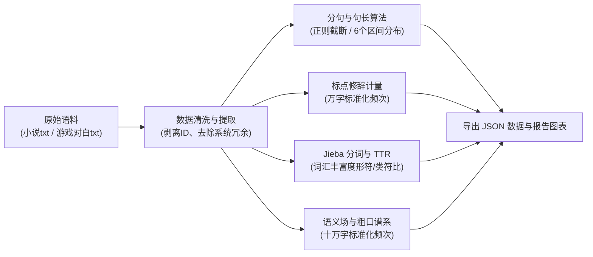

# 词频统计分析程序说明

> **文档说明**：本说明文档归纳了《巫师3》与《猎魔人》跨媒介文本量化对比课题中的数据清洗流程、算法设计、分词统计方法以及完整的 Python 源码与案例抽取实现，可直接作为大作业的技术附录或答辩报告材料。

---

### 一、 具体的统计方法与技术实现流程

整个统计过程遵循了计算语言学（Computational Linguistics）与语料库语言学的标准清洗与分析流：



1. **数据清洗与提取**：
   - **小说语料**：直接读取重庆出版社全七卷合集纯文本（1,568,977 字符）。
   - **游戏对话**：读取 `01_dialogues.txt` 时，游戏引擎台词带有 `[ID]` 前缀（如 `[158473] 你给我闪开！`），通过 `line.split('] ', 1)` 剥离 ID 与技术标记，仅提取纯正对白文本（1,551,793 字符）。
2. **句法切分与句长区间算法（Sentence Segmentation）**：
   - 采用正则表达式 `r'[。！？!?\n]+'` 切分出完整语义单句；
   - 统计每个句子的字符数，计算平均句长（Mean）、中位数（Median）、最大单句长度；
   - 划分为 6 个区间：`≤5字`（极短应答）、`6-10字`（核心短句）、`11-20字`（中度句）、`21-35字`（较长句）、`36-50字`（长难句）、`>50字`（超长复合句），计算占比。
3. **标点与言语行为频次（Punctuation & Speech Acts）**：
   - 用正则精确匹配 `叹号`、`问号`、`省略号`、`破折号`、`逗号`、`句号`；
   - **标准化处理**：折算为**每万字频次（Per 10,000 Chars）**，消除两边总字数微小差异的影响。
4. **粗口与主题语义场分类统计（Keyword Taxonomies）**：
   - 建立语义词典（如欧化诅咒、直率泄愤、市井詈语、草莽方言、哲学形而上、即时行动词、契约经济）；
   - 使用 `re.findall(re.escape(word), text)` 统计精确出现次数；
   - 折算为**每十万字标准化频次（Per 100,000 Chars）**。
5. **词汇多样性 TTR（Type-Token Ratio）**：
   - 针对两部作品各抽取相同规模的 30 万字纯文本切片；
   - 使用结巴分词（`jieba.cut`）进行中文分词并过滤纯符号；
   - 计算公式：TTR = （独立词汇种类数 Types ÷ 分词总词数 Tokens）× 100%
     
### 二、 核心统计 Python 源码

以下是执行全套量化统计的完整 Python 代码（包含详细注释）：

```python
# -*- coding: utf-8 -*-
"""
《巫师3》与《猎魔人》跨媒介文本量化对比统计脚本
依赖库：标准库 (os, sys, re, json, collections) + jieba 分词库
运行方式：python 巫师3与猎魔人语料统计脚本.py
"""

import os
import sys
import re
import json
from collections import Counter
import jieba

# 1. 语料文件路径配置
NOVEL_PATH = r"E:\w3_text\大作业——《巫师3》与《猎魔人》\《猎魔人》小说\猎魔人修订版全集（全七卷）【媲美《冰与火之歌》的波兰国宝级奇幻文学！讲述了一个关于命运和家庭的史诗故事！Netflix同名影视剧集播映！】 (... (z-library.sk, 1lib.sk, z-lib.sk).txt"
GAME_DIALOGUES_PATH = r"E:\w3_text\大作业——《巫师3》与《猎魔人》\解包文本及程序\txt拆分\01_dialogues.txt"

def load_data():
    print("[1/5] 正在读取语料文件...")
    # 读取小说全本
    with open(NOVEL_PATH, 'r', encoding='utf-8', errors='ignore') as f:
        novel_raw = f.read()

    # 读取游戏对话：剔除每行开头的 [ID] 标识，仅保留纯对白文本
    game_dialogue_lines = []
    with open(GAME_DIALOGUES_PATH, 'r', encoding='utf-8', errors='ignore') as f:
        for line in f:
            line = line.strip()
            if line.startswith('['):
                parts = line.split('] ', 1)
                if len(parts) == 2:
                    game_dialogue_lines.append(parts[1])
                else:
                    game_dialogue_lines.append(line)
    game_dialogue_raw = "\n".join(game_dialogue_lines)

    print(f"    - 小说文本：共 {len(novel_raw):,} 字符")
    print(f"    - 游戏对话：共 {len(game_dialogue_raw):,} 字符 (包含 {len(game_dialogue_lines):,} 条对白)")
    return novel_raw, game_dialogue_raw

# 2. 句法切分与句长分布统计
def analyze_sentences(novel_text, game_text):
    print("[2/5] 正在分析句法结构与句长分布...")
    def split_sentences(text):
        return [s.strip() for s in re.split(r'[。！？!?\n]+', text) if len(s.strip()) > 0]

    novel_sents = split_sentences(novel_text)
    game_sents = split_sentences(game_text)

    def calc_sent_metrics(sents):
        lens = [len(s) for s in sents]
        total = len(lens)
        mean_len = sum(lens) / total
        sorted_lens = sorted(lens)
        median_len = sorted_lens[total // 2]
        
        # 6 个句长区间
        b_under_5 = sum(1 for l in lens if l <= 5)
        b_6_10 = sum(1 for l in lens if 6 <= l <= 10)
        b_11_20 = sum(1 for l in lens if 11 <= l <= 20)
        b_21_35 = sum(1 for l in lens if 21 <= l <= 35)
        b_36_50 = sum(1 for l in lens if 36 <= l <= 50)
        b_over_50 = sum(1 for l in lens if l > 50)
        
        return {
            "总句数": total,
            "平均句长(字)": round(mean_len, 2),
            "句长中位数": median_len,
            "最大单句长度": max(lens),
            "区间占比(%)": {
                "≤5字": round(b_under_5 / total * 100, 2),
                "6-10字": round(b_6_10 / total * 100, 2),
                "11-20字": round(b_11_20 / total * 100, 2),
                "21-35字": round(b_21_35 / total * 100, 2),
                "36-50字": round(b_36_50 / total * 100, 2),
                ">50字": round(b_over_50 / total * 100, 2),
            }
        }

    return calc_sent_metrics(novel_sents), calc_sent_metrics(game_sents)

# 3. 标点符号分布统计 (折算为每万字频次)
def analyze_punctuation(novel_text, game_text):
    print("[3/5] 正在统计标点修辞分布...")
    marks = {
        "叹号(!/！)": r'[！!]',
        "问号(?/？)": r'[？?]',
        "省略号(…/...)": r'(?:…|\.{3,})',
        "破折号(——/--)": r'(?:——|--)',
        "逗号(，/,)": r'[，,]',
        "句号(。/.)": r'[。]',
    }

    def count_punct(text):
        total_chars = len(text)
        unit_10k = total_chars / 10000.0
        res = {}
        for name, pattern in marks.items():
            cnt = len(re.findall(pattern, text))
            res[name] = {
                "总频次": cnt,
                "每万字频次": round(cnt / unit_10k, 2)
            }
        return res

    return count_punct(novel_text), count_punct(game_text)

# 4. 粗口、市井俚语与主题关键词频次统计 (折算为每十万字频次)
def analyze_lexical_categories(novel_text, game_text):
    print("[4/5] 正在分类统计粗口、俚语及核心语义词...")
    categories = {
        "【欧化文雅诅咒】": ['见鬼', '见鬼去吧'],
        "【直率情绪泄愤】": ['该死', '去你的', '操', '他妈的', '狗屎'],
        "【市井人身辱骂】": ['混蛋', '混账', '蠢货', '废物', '杂种', '狗娘养的', '狗杂碎'],
        "【性别与道德侮辱】": ['婊子', '荡妇'],
        "【草莽土话代词与口语】": ['老子', '放屁', '扯淡', '奶奶的', '滚蛋', '滚开'],
        "【形而上哲学思辨】": ['命运', '宿命', '预言', '理性', '虚无', '所谓', '中立'],
        "【即时行动与交互指令】": ['走吧', '好吧', '等等', '快点', '快走', '告诉我', '准备好', '怎么回事'],
        "【经济与契约佣金】": ['报酬', '赏金', '克朗', '委托', '钱', '价码']
    }

    def count_words(text):
        total_len_100k = len(text) / 100000.0
        res = {}
        for cat_name, words in categories.items():
            cat_dict = {}
            for w in words:
                cnt = len(re.findall(re.escape(w), text))
                cat_dict[w] = {
                    "频次": cnt,
                    "每十万字标准化频次": round(cnt / total_len_100k, 2)
                }
            res[cat_name] = cat_dict
        return res

    return count_words(novel_text), count_words(game_text)

# 5. 基于 Jieba 分词的词汇多样性 (TTR) 计算
def analyze_ttr(novel_text, game_text, sample_size=300000):
    print(f"[5/5] 正在使用 Jieba 计算词汇丰富度 (各抽样前 {sample_size:,} 字符)...")
    novel_sample = novel_text[:sample_size]
    game_sample = game_text[:sample_size]

    novel_words = [w for w in jieba.cut(novel_sample) if len(w.strip()) > 0 and not re.match(r'^[^\w]+$', w)]
    game_words = [w for w in jieba.cut(game_sample) if len(w.strip()) > 0 and not re.match(r'^[^\w]+$', w)]

    novel_types = len(set(novel_words))
    novel_tokens = len(novel_words)
    game_types = len(set(game_words))
    game_tokens = len(game_words)

    return {
        "小说 (30万字切片)": {
            "类符数 (Unique Types)": novel_types,
            "形符数 (Total Tokens)": novel_tokens,
            "TTR 词汇多样性(%)": round(novel_types / novel_tokens * 100, 2)
        },
        "游戏 (30万字切片)": {
            "类符数 (Unique Types)": game_types,
            "形符数 (Total Tokens)": game_tokens,
            "TTR 词汇多样性(%)": round(game_types / game_tokens * 100, 2)
        }
    }

if __name__ == "__main__":
    novel_raw, game_raw = load_data()
    novel_sent_stat, game_sent_stat = analyze_sentences(novel_raw, game_raw)
    novel_punct, game_punct = analyze_punctuation(novel_raw, game_raw)
    novel_lex, game_lex = analyze_lexical_categories(novel_raw, game_raw)
    ttr_stat = analyze_ttr(novel_raw, game_raw)

    final_report = {
        "语料基础规模": {"小说总字数": len(novel_raw), "游戏对话总字数": len(game_raw)},
        "句法句长对比": {"小说": novel_sent_stat, "游戏": game_sent_stat},
        "标点修辞对比": {"小说": novel_punct, "游戏": game_punct},
        "主题与粗口分类对比": {"小说": novel_lex, "游戏": game_lex},
        "词汇多样性TTR": ttr_stat
    }

    # 保存计算结果为 JSON
    out_file = r"C:\Users\denve\Desktop\witcher_corpus_result.json"
    with open(out_file, "w", encoding="utf-8") as f:
        json.dump(final_report, f, ensure_ascii=False, indent=2)
    print(f"\n[完成] 统计结果已输出至: {out_file}")
```

---

### 三、 典型细读案例的抽取方法

除了量化统计，具体对话与任务日志，是通过**精准正则检索脚本**抽取的：
- **杰洛特特征行检索**：在 `01_dialogues.txt` 中检索关键词 `r'风在呼啸|钱管够|报酬|委托|拔剑'`，并定位到了诸如 `[378414]`、`[349551]` 等具体对话节点；
- **粗口方言检索**：检索 `r'狗杂碎|奶奶的|放屁|老子|操蛋'`，定位到了威伦农民和群岛水手的酒馆对白（如 `[158473]`、`[344771]`、`[351919]`）；
- **任务日志检索**：在 `02_quest_journal.txt` 与 `04_story_compilation.txt` 中检索长度大于 200 字且包含 `丹德里恩` / `杰洛特` 的长篇记述，精准定位到了群岛著名支线《林中之心》（ID: `397254`）的叙事文本。
