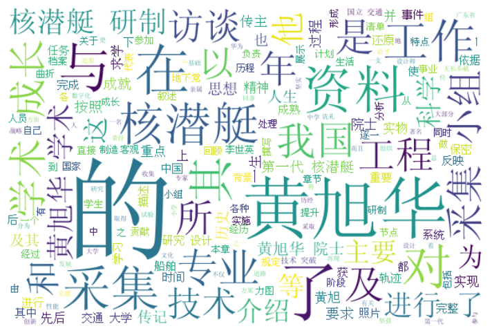
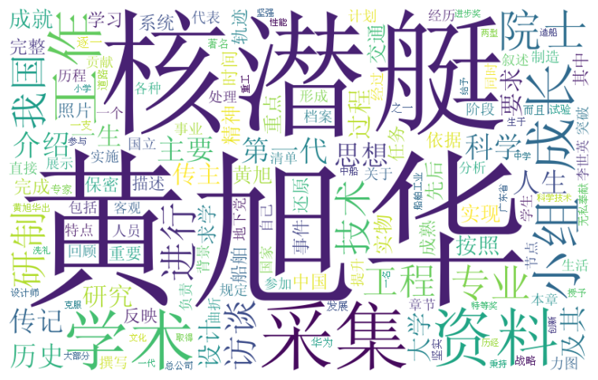
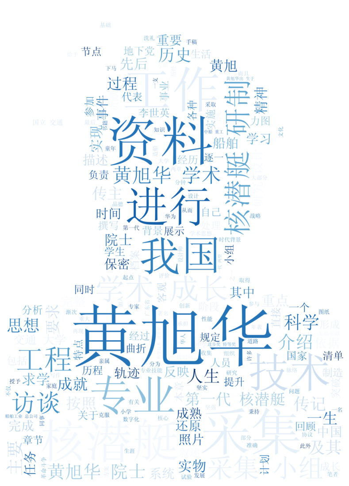
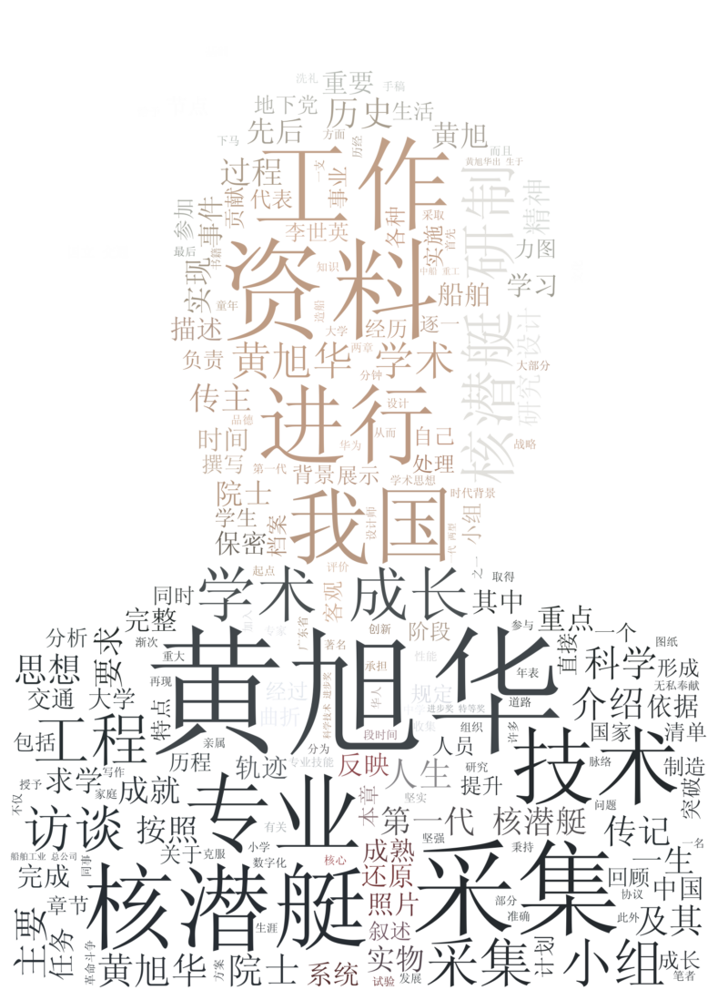

# 黄旭华院士文本的词云制作与参数调优

### 1 首先安装 jieba 分词包与 wordcloud 词云包


```python
# 如果未安装可运行以下命令：
# !pip install jieba
# !pip install -i https://pypi.tuna.tsinghua.edu.cn/simple wordcloud
import jieba
from wordcloud import WordCloud
print('jieba & wordcloud imported successfully!')
```

    jieba & wordcloud imported successfully!
    

### 2 打开功勋科学家黄旭华传记序言文本.txt
这里特别使用 `utf-8-sig` 编码进行读取，自动消除文本开头可能存在的 UTF-8 BOM (`\ufeff`) 标记，避免首词产生异常隐藏字符。

### 3 准备中文字体包
正式编程之前，需要确保同目录下存在 `simsun.ttf`（宋体）中文字体文件，用于中文词云正常显示。


```python
f_cn = open('功勋科学家黄旭华传记序言文本.txt', encoding='utf-8-sig')
```


```python
text_cn = f_cn.read()
```


```python
f_cn.close()
```


```python
text_cn[:50]
```


    '在核潜艇领域，我国已形成一套完整的研究、设计、试验、制造、测试的核潜艇产业体系，而且装备了一支具有极'


### 4 中文分词处理
使用 jieba 对文本进行切分。


```python
import jieba
```


```python
text_cn_word = "/".join(jieba.cut(text_cn))
```

    Building prefix dict from the default dictionary ...
    Loading model from cache C:\Users\denve\AppData\Local\Temp\jieba.cache
    Loading model cost 0.366 seconds.
    Prefix dict has been built successfully.
    


```python
print(text_cn_word[:100])
```

    在/核潜艇/领域/，/我国/已/形成/一套/完整/的/研究/、/设计/、/试验/、/制造/、/测试/的/核潜艇/产业/体系/，/而且/装备/了/一支/具有/极高/战略/威慑力/的/、/成/梯次/配备/
    


```python
print(text_cn_word[:500])
```

    在/核潜艇/领域/，/我国/已/形成/一套/完整/的/研究/、/设计/、/试验/、/制造/、/测试/的/核潜艇/产业/体系/，/而且/装备/了/一支/具有/极高/战略/威慑力/的/、/成/梯次/配备/的/、/已近/实现/战备/巡逻/的/核潜艇/部队/。/回顾/我国/核潜艇/的/发展/历程/，/人们/自然/会/想起/以/黄旭/华为/代表/的/五位/两院/院士/及/无数/第一代/核潜艇/研制/人员/的/皓首穷经/、/筚路蓝缕/、/无私奉献/，/正是/他们/所/铸就/的/国/之/重器/使/我国/彻底/摆脱/了/超级大国/的/核讹诈/，/更/使/我们/在/民族/复兴/的/道路/上/迈出/了/坚实/的/一步/。/
    /而今/，/由/黄旭华/院士/等/人/所/开创/的/核潜艇/工程/以令/世人/震撼/的/力量/，/继续/承载/着/捍卫/“/中国/梦/”/的/伟大/重任/。/
    /黄旭华/是/我国/著名/船舶/专家/、/核潜艇/研究/设计/专家/、/中国工程院/首批/院士/、/中国/第一代/核动力/潜艇/研制/创始人/之一/。/1924/年/2/月/24/日/，/黄旭华出/生于/广东省/汕尾市/海丰县/
    

### 5 初步生成词云（基准效果）
现在按照英文词云的套路对 `text_cn_word` 进行初步词云生成，观察基础效果。


```python
from wordcloud import WordCloud  # 关键代码1
```


```python
wordcloud = WordCloud().generate(text_cn_word) # 关键代码2（无中文字体时中文易乱码）
```


```python
%matplotlib inline
import matplotlib.pyplot as plt
import numpy as np
from PIL import Image
```


```python
# 加入中文字体 simsun.ttf，生成可正确显示汉字的基础词云
wordcloud_cn = WordCloud(font_path="simsun.ttf", width=600, height=400, background_color='white').generate(text_cn_word)
plt.figure(figsize=(10, 6))
plt.imshow(wordcloud_cn, interpolation='bilinear')
plt.axis('off')
plt.show()
```


    

    


## 做第一个改进：停用词过滤与标点符号清洗
词云图里面有很多我们不想要的停用词、标点符号（如引号、顿号）以及单字虚词！我们结合停用词表进行过滤。


```python
# 1. 读取基础停用词表
with open('stop_words.txt', 'r', encoding='utf-8') as f:
    stopwords = set(f.read().split())

# 2. 扩充中文标点符号与空白虚词
punctuation_stopwords = {'“', '”', '《', '》', '、', '，', '。', '：', '；', '？', '！', '（', '）', '【', '】', '…', '—', '·', ' ', '\n', '\t'}
stopwords.update(punctuation_stopwords)
print('停用词集合总数:', len(stopwords))
```

    停用词集合总数: 33
    


```python
f_cn = open('功勋科学家黄旭华传记序言文本.txt', encoding='utf-8-sig')
text_cn = f_cn.read()
f_cn.close()
```


```python
text_cn_word = jieba.cut(text_cn)
```


```python
print(text_cn_word)
```

    <generator object Tokenizer.cut at 0x000002566A479FE0>
    


```python
# 过滤停用词、标点符号，并且过滤掉单字（保留长度大于1的实质词汇，极大去除'所'、'年'、'以'等干扰字）
words_filtered = []
for seg in text_cn_word:
    seg = seg.strip()
    if seg and (seg not in stopwords) and len(seg) > 1:
        words_filtered.append(seg)

# 使用空格拼接为 WordCloud 标准中文分词文本
final = ' '.join(words_filtered)
```


```python
final[:200]
```


    '核潜艇 领域 我国 形成 一套 完整 研究 设计 试验 制造 测试 核潜艇 产业 体系 而且 装备 一支 具有 极高 战略 威慑力 梯次 配备 已近 实现 战备 巡逻 核潜艇 部队 回顾 我国 核潜艇 发展 历程 人们 自然 想起 黄旭 华为 代表 五位 两院 院士 无数 第一代 核潜艇 研制 人员 皓首穷经 筚路蓝缕 无私奉献 正是 他们 铸就 重器 我国 彻底 摆脱 超级大国 核讹诈 我们 民'


```python
# 重新生成矩形词云（基于参数设置进行调优：规范画布尺寸、背景颜色、最大词数与词频相关度）
wordcloud_cn = WordCloud(
    font_path="simsun.ttf",
    width=800,
    height=500,
    background_color='white',
    max_words=150,
    prefer_horizontal=0.9,
    relative_scaling=0.5,
    random_state=42,
    collocations=False
).generate(final)

plt.figure(figsize=(10, 6))
plt.imshow(wordcloud_cn, interpolation='bilinear')
plt.axis('off')
plt.show()
```


    

    


好了！经过停用词与单字清洗后，词云的主题词汇显著聚集。接下来我们给词云换上黄旭华院士的头像遮罩形状！

## 给词云加上特定的形状（基于黄旭华院士头像遮罩）


```python
# 使用 PIL + numpy 规范读取黄旭华头像作为形状遮罩 (Mask)
big_pic = np.array(Image.open('huangxuhua.jpg'))
print('遮罩图片维度与数据类型:', big_pic.shape, big_pic.dtype)
```

    遮罩图片维度与数据类型: (770, 550, 3) uint8
    


```python
# 基于“作业参数设置”全面优化遮罩词云：
# 1. mask: 人物头像遮罩
# 2. scale: 3.0 (高清晰度采样输出，文字极度清晰)
# 3. max_words: 200 (兼顾丰富度与清晰度)
# 4. max_font_size / min_font_size: 110 / 4 (突出主次核心词)
# 5. prefer_horizontal: 0.85 (横纵排版协调，符合视觉习惯)
# 6. relative_scaling: 0.5 (词频与字号合理映射)
# 7. colormap: 'Blues' (科技深海蓝配色，契合核潜艇与科学家主题)
# 8. random_state: 42 (保证排版可复现)

wordcloud_cn_x = WordCloud(
    font_path="simsun.ttf",
    mask=big_pic,
    background_color='white',
    scale=3.0,
    max_words=200,
    max_font_size=110,
    min_font_size=4,
    prefer_horizontal=0.85,
    relative_scaling=0.5,
    random_state=42,
    colormap='Blues'
).generate(final)

plt.figure(figsize=(10, 14))
plt.imshow(wordcloud_cn_x, interpolation='bilinear')
plt.axis('off')
plt.show()
```


    

    


## 保存高清词云图像文件
保存后的图片可以在文件夹中直接打开查看，分辨率极高且轮廓清晰。


```python
wordcloud_cn_x.to_file('huangxuhua_ciyun.jpg')
print('高清头像遮罩词云已成功保存至 huangxuhua_ciyun.jpg')
```

    高清头像遮罩词云已成功保存至 huangxuhua_ciyun.jpg
    

## 进阶作业拓展：基于原图色彩的重新着色 (recolor)
利用 WordCloud 提供的 `ImageColorGenerator`，提取黄旭华院士肖像原图的色彩特征，对词云进行重新着色，使人物五官与服饰细节更加传神逼真。


```python
from wordcloud import ImageColorGenerator

# 提取原图色彩并重新着色
image_colors = ImageColorGenerator(big_pic)
wordcloud_recolor = wordcloud_cn_x.recolor(color_func=image_colors)

plt.figure(figsize=(10, 14))
plt.imshow(wordcloud_recolor, interpolation='bilinear')
plt.axis('off')
plt.show()

# 保存原图色彩版本
wordcloud_recolor.to_file('huangxuhua_ciyun_recolor.jpg')
print('原图色彩版词云已成功保存至 huangxuhua_ciyun_recolor.jpg')
```


    

    


    原图色彩版词云已成功保存至 huangxuhua_ciyun_recolor.jpg
    

## 注意：以下有wordcloud所有参数的设置，供大家作业的时候参考，修改词云效果。


```python
# WordCloud 官方类构造函数签名参考：
# class wordcloud.WordCloud(font_path=None, width=400, height=200, margin=2, ranks_only=None, prefer_horizontal=0.9,
#                           mask=None, scale=1, color_func=None, max_words=200, min_font_size=4, stopwords=None,
#                           random_state=None, background_color='black', max_font_size=None, font_step=1, mode='RGB',
#                           relative_scaling=0.5, regexp=None, collocations=True, colormap=None, normalize_plurals=True)
```

### 基于以上设置作业：WordCloud 核心参数与方法速查表

| 参数 / 方法 | 类型与默认值 | 功能说明与作业调优建议 |
| :--- | :--- | :--- |
| `font_path` | `string` | 字体路径。中文词云**必需**设置（如 `simsun.ttf`），否则汉字显示为乱码方块 |
| `width` / `height` | `int (400 / 200)` | 输出画布宽高（像素）。当指定 `mask` 时，画布宽高由遮罩尺寸决定 |
| `mask` | `nd-array or None` | 遮罩形状数组。纯白（#FFFFFF）区域不绘制，其余区域填充词汇。建议配合清晰黑白/白底剪影图 |
| `scale` | `float (default=1)` | 画布等比放大倍数。本作业设为 `3.0`，大幅提升导出图片的 DPI 与文字边缘锐利度 |
| `prefer_horizontal` | `float (default=0.9)`| 词语水平排版比例（0~1）。本作业设为 `0.85`，使 85% 为横排、15% 为竖排，版面生动平衡 |
| `max_words` | `int (default=200)` | 词云容纳的最大词语数量。设置 `150~200` 既保证人物主体填充饱满，又避免文字拥挤重叠 |
| `max_font_size` / `min_font_size` | `int` | 最大与最小字号。本作业设定 `110 / 4`，显著拉开“黄旭华”、“核潜艇”等主词与细节词的梯度 |
| `font_step` | `int (default=1)` | 字体字号寻位步长。设为 `1` 可最紧密地利用遮罩边界空隙 |
| `stopwords` | `set or None` | 屏蔽停用词集合。与前面的结巴预处理形成双层过滤保障 |
| `background_color` | `color ('black')` | 背景颜色。遮罩背景为白色时必须设为 `'white'`，实现与底图完全融合 |
| `mode` | `string ('RGB')` | 颜色模式。设为 `'RGBA'` 且 `background_color=None` 时可生成透明背景词云 |
| `relative_scaling` | `float (0.5)` | 词频与字体大小的相关性权重。`0.5` 是最佳平衡点，兼顾词频显著性与填充紧凑度 |
| `colormap` | `string ('viridis')` | 调色盘名称。本作业采用 `'Blues'` 科技深蓝系，紧扣中国核潜艇“深海龙宫”科研主题 |
| `random_state` | `int or None` | 随机种子。固定数值（如 `42`）可使每次生成的词云版面完全一致，便于复现与评审 |
| `collocations` | `bool (True)` | 是否统计双词短语搭配。中文词云建议设为 `False`，避免 jieba 已切分词语出现意外粘连 |
| `color_func` / `recolor` | `callable` | 颜色分配函数。通过 `ImageColorGenerator(mask)` 能够提取人物原图色彩还原写实效果 |
| `to_file(filename)` | `method` | 将渲染完成的词云导出为指定格式图片（.jpg / .png） |

#作业完成总结

扩充了中文引号、顿号、句号等标点停用词，滤除了大量诸如“所”、“年”、“以”、“个”等无意义单字虚词，词频最高的核心词汇（黄旭华 53次、核潜艇 32次、采集 29次、学术 22次）得到了极佳的视觉聚焦。

