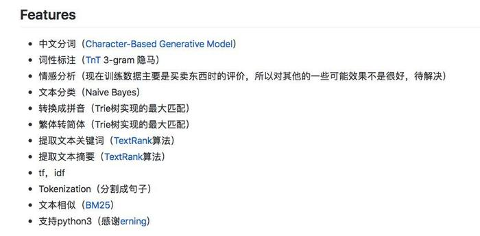

# 情感分析-初级

[参考网址在这里](https://www.jianshu.com/p/d50a14541d01)

首先，需要安装情感分析的运行环境，也就是一些必要的程序包
+ 在anaconda prompt里面运行


```python
!pip install snownlp
!pip install -U textblob
!python -m textblob.download_corpora
```

    Requirement already satisfied: snownlp in C:\Users\denve\anaconda3\Lib\site-packages (0.12.3)
    Requirement already satisfied: textblob in C:\Users\denve\anaconda3\Lib\site-packages (0.20.1)
    Requirement already satisfied: nltk>=3.9 in C:\Users\denve\anaconda3\Lib\site-packages (from textblob) (3.10.0)
    Requirement already satisfied: defusedxml in C:\Users\denve\anaconda3\Lib\site-packages (from nltk>=3.9->textblob) (0.7.1)
    Requirement already satisfied: click in C:\Users\denve\anaconda3\Lib\site-packages (from nltk>=3.9->textblob) (8.4.1)
    Requirement already satisfied: joblib in C:\Users\denve\anaconda3\Lib\site-packages (from nltk>=3.9->textblob) (1.5.3)
    Requirement already satisfied: regex>=2021.8.3 in C:\Users\denve\anaconda3\Lib\site-packages (from nltk>=3.9->textblob) (2026.5.9)
    Requirement already satisfied: tqdm in C:\Users\denve\anaconda3\Lib\site-packages (from nltk>=3.9->textblob) (4.68.2)
    Requirement already satisfied: colorama in C:\Users\denve\anaconda3\Lib\site-packages (from click->nltk>=3.9->textblob) (0.4.6)
    

## 英文


```python
# 英文调出TextBlob NLP处理包
```




```python
text = "I am happy today. I feel sad today."
```


```python
from textblob import TextBlob
blob = TextBlob(text)
```


```python
blob
```


```python
# 原封不动的打印出来了？
# 实际上已经把文本分成了句子了，看一看
blob.sentences
```


```python
blob.sentences[0].sentiment
```


```python
# 上面的结果什么意思呢？
# 情感极性0.8，主观性1.0。说明一下，情感极性的变化范围是[-1, 1]，-1代表完全负面，1代表完全正面。
# 我表达的是我很高兴，那么这个结果是对的
```


```python
blob.sentences[1].sentiment
```


```python
# 整段文本的情感呢？
blob.sentiment
```


```python
# 你可能会觉得没有道理。怎么一句“高兴”，一句“沮丧”，合并起来最后会得到正向结果呢？
# 首先不同极性的词，在数值上是有区别的。我们应该可以找到比“沮丧”更为负面的词汇。而且这也符合逻辑，谁会这么“天上一脚，地下一脚”矛盾地描述自己此时的心情呢？
```

##  中文


```python
# 中文分析，用的是SnowNLP包
```


```python
text_cn = u"我今天很快乐。我今天很愤怒。"
```


```python
#注意在引号前面我们加了一个字母u，它很重要。因为它提示Python，“这一段我们输入的文本编码格式是Unicode，别搞错了哦”。至于文本编码格式的细节，有机会我们再详细聊。
```


```python
from snownlp import SnowNLP
```


```python
senti_cn = SnowNLP(text_cn)
```


```python
# 看看snownlp包的分句能力
for sentence in senti_cn.sentences:
    print(sentence)
```


```python
senti_cn_1 = SnowNLP(senti_cn.sentences[0])
```


```python
# 一个细节上的问题，英文是x.sentiment,中文是x.sentiments，多了一个s
# 另外，在句法上和英文的也略有不同，比如直接用语句：senti_cn.sentences[0].sentiments是会报错的
senti_cn_1.sentiments
```


```python
senti_cn_2 = SnowNLP(senti_cn.sentences[1])
```


```python
senti_cn_2.sentiments
```

这里你肯定发现了问题——“愤怒”这个词表达了如此强烈的负面情感，为何得分依然是正的？

这是因为SnowNLP和textblob的计分方法不同。SnowNLP的情感分析取值，表达的是“这句话代表正面情感的概率”。也就是说，对“我今天很愤怒”一句，SnowNLP认为，它表达正面情感的概率很低很低。

这样解释就是ok了


```python
senti_cn.sentiments
```


```python
# 整个句子，貌似就有问题了
```

## 作业

注：设计课程的时候，可以把作业单独拿出来，放在另外一个文档中

从淘宝或者其他平台上找一些评论的句子来试一试，它的情感值是多少。


```python
# 例如
text_taobao_1 = "显示效果: 挺好的 运行速度: 目前来说很流畅 拍照效果: 拍照效果挺好的 电池续航: 一天一冲 总结: 目前没啥毛病，用了一天的体验"
```


```python
taobao_1 = SnowNLP(text_taobao_1)
```


```python
taobao_1.sentiments
```


```python
text_taobao_2 = "总结: 这是我买过最不满意的一款手机！两千多元的手机这样，真的很不值！"
```


```python
taobao_2 = SnowNLP(text_taobao_2)
```


```python
for sentence in taobao_2.sentences:
    print(sentence)
```


```python
taobao_2.sentiments
```


```python
# 以上的结果看上去是有问题的。分析的不准确。
```


```python
text_taobao_3 = "显示效果: 像素不行 运行速度: 微信有时发给不了语音，得重新开机后才能发，才买半个月的手机就这样，客服态度也很差！ 拍照效果: 拍照不清晰！ 电池续航: 手机不蓄电，充满电后用半天就没电了，一天得充两次电！！ 总结: 这是我买过最不满意的一款手机！两千多元的手机这样，真的很不值！"
```


```python
taobao_3 = SnowNLP(text_taobao_3)
```


```python
# 这一长句的结果还是可以的，非常小的概率值了
```


```python
# 你的例句呢？
```


```python
# 例句1
```


```python
text_taobao_4 = "这个蓝色的小鲨鱼靠枕很舒服很可爱真是很好太喜欢了呀"
```


```python
taobao_4 = SnowNLP(text_taobao_4)
```


```python
taobao_4.sentiments
```


```python
# 例句2
```


```python
text_taobao_5 = "维密这款茶香身体乳我可太喜欢啦！淡淡的茶香清爽不腻，质地顺滑好推开，上肤不粘手，保湿力在线，涂完整天都带着舒服的香气，会回购!"
```


```python
taobao_5 = SnowNLP(text_taobao_5)
```


```python
taobao_5.sentiments
```


```python
# 查看原博客的地址，了解下有时候分析结果不准确的原因。
```


```python

```
