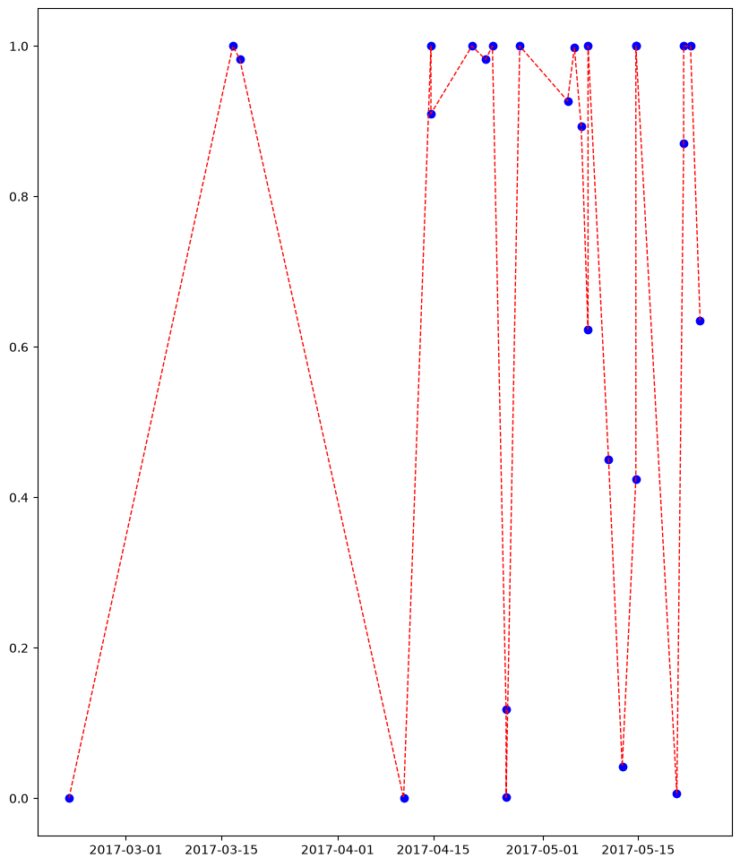

# 情感分析-高级-时间序列

### 工作步骤
+ 1 能够知道如何处理excel文件
+ 2 怎么用snownlp处理一句话的情感，生成情感值
+ 3 如何批量的按行、快速生成每行文本的情感值  .apply
+ 4 怎么把情感的趋势线画出来
准备工作，之前已经安装了snownlp整个包，还要安装ggplot这个包
pip install ggplot

```python
import pandas as pd # pandas用来处理表格数据的工具包
```


```python
df = pd.read_excel("restaurant-comments.xlsx")
```


```python
df.head()
```


<div>
<style scoped>
    .dataframe tbody tr th:only-of-type {
        vertical-align: middle;
    }

    .dataframe tbody tr th {
        vertical-align: top;
    }

    .dataframe thead th {
        text-align: right;
    }
</style>
<table border="1" class="dataframe">
  <thead>
    <tr style="text-align: right;">
      <th></th>
      <th>comments</th>
      <th>date</th>
    </tr>
  </thead>
  <tbody>
    <tr>
      <th>0</th>
      <td>这辈子最爱吃的火锅，一星期必吃一次啊！最近才知道他家还有免费鸡蛋羹………………炒鸡好吃炒鸡嫩...</td>
      <td>2017-05-14 16:00:00</td>
    </tr>
    <tr>
      <th>1</th>
      <td>第N次来了，还是喜欢?……&lt;br&gt;&lt;br&gt;从还没上A餐厅的楼梯开始，服务员已经在那迎宾了，然...</td>
      <td>2017-05-10 16:00:00</td>
    </tr>
    <tr>
      <th>2</th>
      <td>大姨过生日，姐姐定的这家A餐厅的包间，服务真的是没得说，A餐厅的服务也是让我由衷的欣赏，很久...</td>
      <td>2017-04-20 16:00:00</td>
    </tr>
    <tr>
      <th>3</th>
      <td>A餐厅的服务哪家店都一样，体贴入微。这家店是我吃过的排队最短的一家，当然也介于工作日且比较晚...</td>
      <td>2017-04-25 16:00:00</td>
    </tr>
    <tr>
      <th>4</th>
      <td>因为下午要去天津站接人，然后我倩前几天就说想吃A餐厅，然后正好这有，就来这吃了。&lt;br&gt;来的...</td>
      <td>2017-05-21 16:00:00</td>
    </tr>
  </tbody>
</table>
</div>


# 注意这里的时间列。如果你的Excel文件里的时间格式跟此处一样，包含了日期和时间，那么Pandas会非常智能地帮你把它识别为时间格式，接着往下做就可以了。

反之，如果你获取到的时间只精确到日期，例如"2017-04-20"这样，那么Pandas只会把它当做字符串，后面的时间序列分析无法使用字符串数据。解决办法是在这里加入以下两行代码：

from dateutil import parser
df["date"] = df.date.apply(parser.parse)

这样，你就获得了正确的时间数据了

```python
text = df.comments.iloc[0]  # iloc是索引（用来定位到指定的位置），这里就是第一条评论文本
```


```python
text
```


    '这辈子最爱吃的火锅，一星期必吃一次啊！最近才知道他家还有免费鸡蛋羹………………炒鸡好吃炒鸡嫩啊！！新出的红皮土豆也好好吃，还有炸酥肉，秒杀任何火锅店啊！服务员太可爱，告诉我们半份豆花是4块儿，一份豆花是6块儿，点两个半份比较合适，太实在了哈哈哈，每次妈妈说开心果好吃服务员都给我们打包带走??希望A餐厅早日出咖喱锅，期待ing……'


```python
from snownlp import SnowNLP
```


```python
s = SnowNLP(text)
```


```python
s.sentiments
```


    0.4244401030222834


情感分析数值可以正确计算。在此基础上，我们需要定义函数，以便批量处理所有的评论信息。


```python
def get_sentiment_cn(text):
    s = SnowNLP(text)
    return s.sentiments  # snownlp是通用的，就没那么准确
```

然后，我们利用Python里面强大的apply语句，来一次性处理所有评论，并且将生成的情感数值在数据框里面单独存为一列，称为sentiment。


```python
df["sentiments"] = df.comments.apply(get_sentiment_cn)  #这行代码很有意思！
```


```python
df.head(100)
```


<div>
<style scoped>
    .dataframe tbody tr th:only-of-type {
        vertical-align: middle;
    }

    .dataframe tbody tr th {
        vertical-align: top;
    }

    .dataframe thead th {
        text-align: right;
    }
</style>
<table border="1" class="dataframe">
  <thead>
    <tr style="text-align: right;">
      <th></th>
      <th>comments</th>
      <th>date</th>
      <th>sentiments</th>
    </tr>
  </thead>
  <tbody>
    <tr>
      <th>0</th>
      <td>这辈子最爱吃的火锅，一星期必吃一次啊！最近才知道他家还有免费鸡蛋羹………………炒鸡好吃炒鸡嫩...</td>
      <td>2017-05-14 16:00:00</td>
      <td>4.244401e-01</td>
    </tr>
    <tr>
      <th>1</th>
      <td>第N次来了，还是喜欢?……&lt;br&gt;&lt;br&gt;从还没上A餐厅的楼梯开始，服务员已经在那迎宾了，然...</td>
      <td>2017-05-10 16:00:00</td>
      <td>4.506914e-01</td>
    </tr>
    <tr>
      <th>2</th>
      <td>大姨过生日，姐姐定的这家A餐厅的包间，服务真的是没得说，A餐厅的服务也是让我由衷的欣赏，很久...</td>
      <td>2017-04-20 16:00:00</td>
      <td>1.000000e+00</td>
    </tr>
    <tr>
      <th>3</th>
      <td>A餐厅的服务哪家店都一样，体贴入微。这家店是我吃过的排队最短的一家，当然也介于工作日且比较晚...</td>
      <td>2017-04-25 16:00:00</td>
      <td>1.182003e-01</td>
    </tr>
    <tr>
      <th>4</th>
      <td>因为下午要去天津站接人，然后我倩前几天就说想吃A餐厅，然后正好这有，就来这吃了。&lt;br&gt;来的...</td>
      <td>2017-05-21 16:00:00</td>
      <td>8.712261e-01</td>
    </tr>
    <tr>
      <th>5</th>
      <td>A餐厅是我们的定点单位，单位大聚小聚都来这，所以享受VIP待遇，来了不用等位。这的菜品新鲜，...</td>
      <td>2017-05-05 16:00:00</td>
      <td>9.980202e-01</td>
    </tr>
    <tr>
      <th>6</th>
      <td>这两天风特别大，家里也没什么可吃的，外卖也不知道吃什么！又懒得出去，发现好久没吃火锅啦！灵机...</td>
      <td>2017-04-22 16:00:00</td>
      <td>9.820584e-01</td>
    </tr>
    <tr>
      <th>7</th>
      <td>A餐厅真的是天津每一个店我都来过无数次了！&lt;br&gt;今天觉得我拍的图很好看hhhh于是就来发条...</td>
      <td>2017-05-20 16:00:00</td>
      <td>6.392747e-03</td>
    </tr>
    <tr>
      <th>8</th>
      <td>今天又来到新开路的A餐厅，食材还是非常新鲜，羔羊肉味道鲜美，墨鱼滑味道新鲜！我们一家三口吃的...</td>
      <td>2017-05-12 16:00:00</td>
      <td>4.267672e-02</td>
    </tr>
    <tr>
      <th>9</th>
      <td>服务态度一如既往的好，看我东西多，主动帮忙提东西，所有的服务员都主动打招呼，非常热情。我点的...</td>
      <td>2017-05-07 16:00:00</td>
      <td>6.235047e-01</td>
    </tr>
    <tr>
      <th>10</th>
      <td>服务好赞！外送小哥实际A餐厅自己配的，送之前一个电话说别急已经在送的路上，送到后也一个电话说...</td>
      <td>2017-04-10 16:00:00</td>
      <td>1.965386e-04</td>
    </tr>
    <tr>
      <th>11</th>
      <td>服务一如既往的这么赞、论食材是火锅中的精粹，论服务也绝对是龙头老大！人多最爱来吃A餐厅了、每...</td>
      <td>2017-04-23 16:00:00</td>
      <td>9.999997e-01</td>
    </tr>
    <tr>
      <th>12</th>
      <td>一直特别特别特别爱A餐厅真的服务太贴心了细节决定一切呀用餐的时候接了个电话无意中跟朋友说今天...</td>
      <td>2017-05-07 16:00:00</td>
      <td>9.999998e-01</td>
    </tr>
    <tr>
      <th>13</th>
      <td>服务没的说啊，非常的周到啊，从始至终不用自己喊服务员，主动的倒饮料，帮我们下肉，吃完还给我们...</td>
      <td>2017-05-14 16:00:00</td>
      <td>9.999515e-01</td>
    </tr>
    <tr>
      <th>14</th>
      <td>口味还不错?点了一份蛋炒饭，加荷包蛋?溏心的。捞派捞面?还不错，菌汤番茄?的都好吃。炸馒头一...</td>
      <td>2017-05-14 16:00:00</td>
      <td>9.999862e-01</td>
    </tr>
    <tr>
      <th>15</th>
      <td>话说我真的很久很久没有吃A餐厅了，朋友想吃，我俩就过来了。她喜欢番茄锅，所以我们点了牛油麻辣...</td>
      <td>2017-04-25 16:00:00</td>
      <td>1.215408e-03</td>
    </tr>
    <tr>
      <th>16</th>
      <td>提前预订的因为孩子生日孩子们又喜欢那的口味服务我就不都说了一如既往的优质每位服务员态度都是那...</td>
      <td>2017-04-27 16:00:00</td>
      <td>1.000000e+00</td>
    </tr>
    <tr>
      <th>17</th>
      <td>A餐厅新开路店是在天津所有A餐厅门店当中，我最愿意光临的，因为这里停车方便，排队人也不像其他...</td>
      <td>2017-03-17 16:00:00</td>
      <td>9.827555e-01</td>
    </tr>
    <tr>
      <th>18</th>
      <td>再次来享受A餐厅的服务，真是好，等位的时候可以下棋等餐，而且有美甲做，需要排队很久，柠檬水不...</td>
      <td>2017-05-06 16:00:00</td>
      <td>8.931110e-01</td>
    </tr>
    <tr>
      <th>19</th>
      <td>服务和味道一如既往的好，主要最爱吃他家DIY的小料！这次还用手机扫了个公众平台用一楼的照片打...</td>
      <td>2017-04-14 16:00:00</td>
      <td>9.998846e-01</td>
    </tr>
    <tr>
      <th>20</th>
      <td>A餐厅的服务一直很好，光顾很多次了，这次去是小伙伴们帮忙预定，为我庆生，A餐厅的工作人员还提...</td>
      <td>2017-05-21 16:00:00</td>
      <td>1.000000e+00</td>
    </tr>
    <tr>
      <th>21</th>
      <td>今天下班，和朋友说好去吃A餐厅?，到那没有排队就可以直接进去吃??，点了它这新品，红皮土豆，...</td>
      <td>2017-04-14 16:00:00</td>
      <td>9.100772e-01</td>
    </tr>
    <tr>
      <th>22</th>
      <td>1.环境还好，算中等。&lt;br&gt;2.服务不错，越来越好，有生日布置，原来送小蛋糕，现在改果盘中...</td>
      <td>2017-05-04 16:00:00</td>
      <td>9.270364e-01</td>
    </tr>
    <tr>
      <th>23</th>
      <td>A餐厅火锅&lt;br&gt;上周五带对象去吃的，我本人对火锅不是特别爱吃，吃不了辣，对象喜欢吃辣的，就...</td>
      <td>2017-03-16 16:00:00</td>
      <td>9.999957e-01</td>
    </tr>
    <tr>
      <th>24</th>
      <td>这次是在情人节当天过去的，以前从来没在情人节正日子出来过，不是因为没有男朋友，而是感觉哪哪人...</td>
      <td>2017-02-20 16:00:00</td>
      <td>6.334066e-08</td>
    </tr>
    <tr>
      <th>25</th>
      <td>一直喜欢A餐厅，去过其他店，这次陪父母来他家体验。排队等待时服务员很贴心的送来小吃，很温馨。...</td>
      <td>2017-05-22 16:00:00</td>
      <td>9.999988e-01</td>
    </tr>
    <tr>
      <th>26</th>
      <td>家门口经常去服务没的说环境也挺好的</td>
      <td>2017-05-24 01:50:00</td>
      <td>6.348401e-01</td>
    </tr>
  </tbody>
</table>
</div>


新的列sentiment已经生成。我们之前介绍过，SnowNLP的结果取值范围在0到1之间，代表了情感分析结果为正面的可能性。通过观察前几条数据，我们发现点评网站上，顾客对这家分店评价总体上还是正面的，而且有的评论是非常积极的。

但是少量数据的观察，可能造成我们结论的偏颇。我们来把所有的情感分析结果数值做一下平均。使用mean()函数即可。


```python
df.sentiments.mean()
```


    np.float64(0.6987503312852683)


整体接近0.7，正面。我们再来看看中位数值，使用的函数为median()。


```python
df.sentiments.median()
```


    np.float64(0.9270364310550024)


我们发现了有趣的现象——中位数值不仅比平均值高，而且几乎接近1（完全正面）。
这就意味着，大部分的评价一边倒表示非常满意。但是存在着少部分异常点，显著拉低了平均值。
下面我们用情感的时间序列可视化功能，直观查看这些异常点出现在什么时间，以及它们的数值究竟有多低。
我们需要使用ggplot绘图工具包。这个工具包原本只在R语言中提供，让其他数据分析工具的用户羡慕得流口水。幸好，后来它很快被移植到了Python平台。

我们从ggplot中引入绘图函数，并且让Jupyter Notebook可以直接显示图像。


```python
%pylab inline
```

    %pylab is deprecated, use %matplotlib inline and import the required libraries.
    Populating the interactive namespace from numpy and matplotlib
    

    C:\Users\denve\anaconda3\Lib\site-packages\IPython\core\magics\pylab.py:166: UserWarning: pylab import has clobbered these variables: ['text']
    `%matplotlib` prevents importing * from pylab and numpy
      warn("pylab import has clobbered these variables: %s"  % clobbered +
    


```python
import matplotlib.pyplot as plt
#plt.scatter(df["date"],df["sentiments"],color='blue',figsize=(10,12))
plt.figure(figsize=(10, 12)) 
plt.scatter(df["date"],df["sentiments"],color='blue')
df = df.sort_values("date")
plt.plot(df["date"],df["sentiments"],color='red',linestyle='--',linewidth =1)
plt.show()
```


    

    


```python
plt.savefig('timeline.png') # 看不到？改一改？
```


    <Figure size 640x480 with 0 Axes>


在图中，我们发现许多正面评价情感分析数值极端的高。同时，我们也清晰地发现了那几个数值极低的点。对应评论的情感分析数值接近于0。这几条评论，被Python判定为基本上没有正面情感了。

从时间上看，最近一段时间，几乎每隔几天就会出现一次比较严重的负面评价。

作为经理，你可能如坐针毡。希望尽快了解发生了什么事儿。你不用在数据框或者Excel文件里面一条条翻找情感数值最低的评论。Python数据框Pandas为你提供了非常好的排序功能。假设你希望找到所有评论里情感分析数值最低的那条，可以这样执行：


```python
df.sort_values(['sentiments'])[:1]
```


<div>
<style scoped>
    .dataframe tbody tr th:only-of-type {
        vertical-align: middle;
    }

    .dataframe tbody tr th {
        vertical-align: top;
    }

    .dataframe thead th {
        text-align: right;
    }
</style>
<table border="1" class="dataframe">
  <thead>
    <tr style="text-align: right;">
      <th></th>
      <th>comments</th>
      <th>date</th>
      <th>sentiments</th>
    </tr>
  </thead>
  <tbody>
    <tr>
      <th>24</th>
      <td>这次是在情人节当天过去的，以前从来没在情人节正日子出来过，不是因为没有男朋友，而是感觉哪哪人...</td>
      <td>2017-02-20 16:00:00</td>
      <td>6.334066e-08</td>
    </tr>
  </tbody>
</table>
</div>


情感分析结果数值几乎就是0啊！不过这里数据框显示评论信息不完全。我们需要将评论整体打印出来。


```python
print(df.sort_values(['sentiments']).iloc[0].comments)
```

    这次是在情人节当天过去的，以前从来没在情人节正日子出来过，不是因为没有男朋友，而是感觉哪哪人都多，所以特意错开，这次实在是馋A餐厅了，所以赶在正日子也出来了，从下午四点多的时候我看排号就排到一百多了，我从家开车过去得堵的话一个小时，我一看提前两个小时就在网上先排着号了，差不多我们是六点半到的，到那的时候我看号码前面还有才三十多号，我想着肯定没问题了，等一会就能吃上的，没想到悲剧了，就从我们到那坐到等位区开始，大约是十分二十分一叫号，中途多次我都想走了，哈哈，哎，等到最后早上九点才吃上的，服务员感觉也没以前清闲时周到了，不过这肯定的，一人负责好几桌，今天节日这么多人，肯定是很累的，所以大多也都是我自己跑腿，没让服务员给弄太多，就虾滑让服务员下的，然后环境来说感觉卫生方面是不错，就是有些太吵了，味道还是一如既往的那个味道，不过A餐厅最人性化的就是看我们等了两个多小时，上来送了我们一张打折卡，而且当次就可以使用，这点感觉还是挺好的，不愧是A餐厅，就是比一般的要人性化，不过这次就是选错日子了，以后还是得提前预约，要不就别赶节日去，太火爆了！
    

## 分析

+ 通过阅读，你可以发现这位顾客确实有了一次比较糟糕的体验——等候的时间太长了，以至于使用了“悲剧”一词；另外还提及服务不够周到，以及环境吵闹等因素。正是这些词汇的出现，使得分析结果数值非常低。
+ 好在顾客很通情达理，而且对该分店的人性化做法给予了正面的评价。
+ 从这个例子，你可以看出，虽然情感分析可以帮你自动化处理很多内容，然而你不能完全依赖它。
+ 自然语言的分析，不仅要看表达强烈情感的关键词，也需要考虑到表述方式和上下文等诸多因素。这些内容，是现在自然语言处理领域的研究前沿。我们期待着早日应用到科学家们的研究成果，提升情感分析的准确度。
+ 不过，即便目前的情感分析自动化处理不能达到非常准确，却依然可以帮助你快速定位到那些可能有问题的异常点(anomalies)。从效率上，比人工处理要高出许多。
+ 你读完这条评论，长出了一口气。总结了经验教训后，你决定将人性化的服务贯彻到底。你又想到，可以收集用户等候时长数据，用数据分析为等待就餐的顾客提供更为合理的等待时长预期。这样就可以避免顾客一直等到很晚了。
+ 祝贺你，经理！在数据智能时代，你已经走在了正确的方向上。


```python

```


```python

```


```python

```
