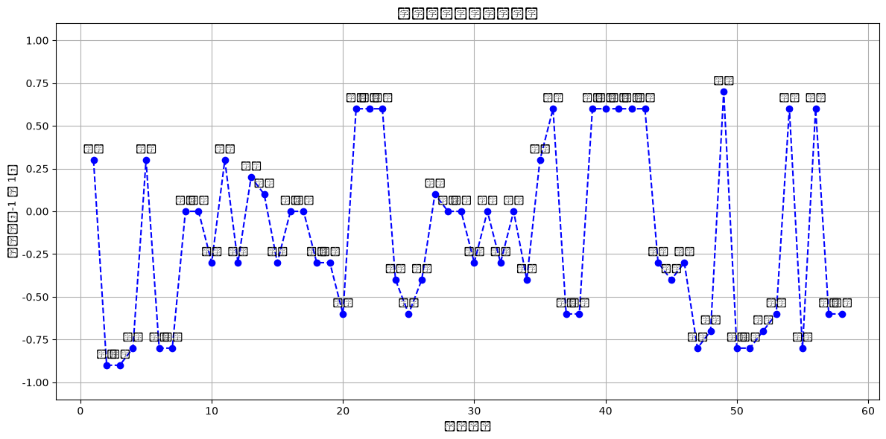

## 在deepseek api平台申请API，拿到API-key；然后交一点钱，很便宜的。


```python
# https://platform.deepseek.com/transactions
```


### 文学作品的情感轨迹
+ 步骤是这样的：
+ 1）读取txt文本，按照句号、感叹号，对文本进行分句，并且对句子进行编号；
+ 2）使用大语言模型，提取以上编号句子，每句话中的情感词，或者隐含的情感实体；
+ 3）用大语言模型计算出，每一个情感词或者情感词所在句子的情感得分；
+ 4）然后绘制一个时间序列的可视化图，横坐标是句子的序号，纵坐标是情感得分，每一个散点是句子对应的情感词，情感词作为散点的标签，然后用虚线把这些情感词连起来。


```python
import re

with open("背影.txt", "r", encoding="utf-8") as f:
    text = f.read()

# 按照句号、感叹号进行分句（保留标点）
sentences = re.split(r'(?<=[。！])', text)
sentences = [s.strip() for s in sentences if s.strip()]
numbered_sentences = [(i + 1, s) for i, s in enumerate(sentences)]
#numbered_sentences = numbered_sentences[0:5] #大模型抽取很慢，提取文本的前n条句子

for num, sent in numbered_sentences:
    print(f"{num}: {sent}")

```

    1: 我与父亲不相见已二年余了，我最不能忘记的是他的背影。
    2: 那年冬天，祖母死了，父亲的差使也交卸了，正是祸不单行的日子。
    3: 我从北京到徐州，打算跟着父亲奔丧回家。
    4: 到徐州见着父亲，看见满院狼藉的东西，又想起祖母，不禁簌簌地流下眼泪。
    5: 父亲说：“事已如此，不必难过，好在天无绝人之路！
    6: ”
    回家变卖典质，父亲还了亏空；又借钱办了丧事。
    7: 这些日子，家中光景很是惨澹，一半为了丧事，一半为了父亲赋闲。
    8: 丧事完毕，父亲要到南京谋事，我也要回北京念书，我们便同行。
    9: 到南京时，有朋友约去游逛，勾留了一日；第二日上午便须渡江到浦口，下午上车北去。
    10: 父亲因为事忙，本已说定不送我，叫旅馆里一个熟识的茶房陪我同去。
    11: 他再三嘱咐茶房，甚是仔细。
    12: 但他终于不放心，怕茶房不妥帖；颇踌躇了一会。
    13: 其实我那年已二十岁，北京已来往过两三次，是没有什么要紧的了。
    14: 他踌躇了一会，终于决定还是自己送我去。
    15: 我再三劝他不必去；他只说：“不要紧，他们去不好！
    16: ”
    我们过了江，进了车站。
    17: 我买票，他忙着照看行李。
    18: 行李太多了，得向脚夫⑾行些小费才可过去。
    19: 他便又忙着和他们讲价钱。
    20: 我那时真是聪明过分，总觉他说话不大漂亮，非自己插嘴不可，但他终于讲定了价钱；就送我上车。
    21: 他给我拣定了靠车门的一张椅子；我将他给我做的紫毛大衣铺好座位。
    22: 他嘱我路上小心，夜里要警醒些，不要受凉。
    23: 又嘱托茶房好好照应我。
    24: 我心里暗笑他的迂；他们只认得钱，托他们只是白托！
    25: 而且我这样大年纪的人，难道还不能料理自己么？我现在想想，我那时真是太聪明了。
    26: 我说道：“爸爸，你走吧。
    27: ”他往车外看了看，说：“我买几个橘子去。
    28: 你就在此地，不要走动。
    29: ”我看那边月台的栅栏外有几个卖东西的等着顾客。
    30: 走到那边月台，须穿过铁道，须跳下去又爬上去。
    31: 父亲是一个胖子，走过去自然要费事些。
    32: 我本来要去的，他不肯，只好让他去。
    33: 我看见他戴着黑布小帽，穿着黑布大马褂，深青布棉袍，蹒跚⒀地走到铁道边，慢慢探身下去，尚不大难。
    34: 可是他穿过铁道，要爬上那边月台，就不容易了。
    35: 他用两手攀着上面，两脚再向上缩；他肥胖的身子向左微倾，显出努力的样子。
    36: 这时我看见他的背影，我的泪很快地流下来了。
    37: 我赶紧拭干了泪。
    38: 怕他看见，也怕别人看见。
    39: 我再向外看时，他已抱了朱红的橘子往回走了。
    40: 过铁道时，他先将橘子散放在地上，自己慢慢爬下，再抱起橘子走。
    41: 到这边时，我赶紧去搀他。
    42: 他和我走到车上，将橘子一股脑儿放在我的皮大衣上。
    43: 于是扑扑衣上的泥土，心里很轻松似的。
    44: 过一会儿说：“我走了，到那边来信！
    45: ”我望着他走出去。
    46: 他走了几步，回过头看见我，说：“进去吧，里边没人。
    47: ”等他的背影混入来来往往的人里，再找不着了，我便进来坐下，我的眼泪又来了。
    48: 近几年来，父亲和我都是东奔西走，家中光景是一日不如一日。
    49: 他少年出外谋生，独力支持，做了许多大事。
    50: 哪知老境却如此颓唐！
    51: 他触目伤怀，自然情不能自已。
    52: 情郁于中，自然要发之于外；家庭琐屑便往往触他之怒。
    53: 他待我渐渐不同往日。
    54: 但最近两年不见，他终于忘却我的不好，只是惦记着我，惦记着我的儿子。
    55: 我北来后，他写了一信给我，信中说道：“我身体平安，惟膀子疼痛厉害，举箸提笔，诸多不便，大约大去之期不远矣。
    56: ”我读到此处，在晶莹的泪光中，又看见那肥胖的、青布棉袍黑布马褂的背影。
    57: 唉！
    58: 我不知何时再能与他相见！
    


```python
import requests
import time
import re

API_KEY = "替换加密" #替换成你自己的密钥
API_URL = "https://api.deepseek.com/v1/chat/completions"

headers = {
    "Content-Type": "application/json",
    "Authorization": f"Bearer {API_KEY}"
}

emotion_results = []

for num, sent in numbered_sentences:
    prompt = f"""你是一个情感分析助手。请对下面这句话做如下分析：

1. 提取或生成一个最能代表情绪的词语（只能一个）；
2. 对整句话的情绪进行打分，范围是 -1（非常负面）到 1（非常正面），中性为 0。

直接用如下格式输出：
情感词：XXX
情感值：X.X

句子：{sent}"""

    data = {
        "model": "deepseek-chat",
        "messages": [{"role": "user", "content": prompt}],
        "temperature": 0.3
    }

    try:
        response = requests.post(API_URL, headers=headers, json=data)
        time.sleep(0.1)  # 控制请求频率

        if response.status_code == 200:
            content = response.json()['choices'][0]['message']['content']
            
            # 宽容匹配格式，如：情感词：悲伤、情感值：-0.6
            match = re.search(r"情感词[:：]?\s*([^\n\r：:\s]+)\s*[\n\r]+情感值[:：]?\s*(-?\d+(?:\.\d+)?)", content)
            if match:
                word = match.group(1)
                score = float(match.group(2))
                emotion_results.append((num, sent, word, score))
            else:
                print(f"[⚠️ 无法匹配] 第{num}句：{sent}")
                print("模型输出：", content)
                emotion_results.append((num, sent, "无", 0.0))
        else:
            print(f"[❌ API错误 {response.status_code}]")
            print(response.text)
            emotion_results.append((num, sent, "无", 0.0))

    except Exception as e:
        print(f"[异常] 第{num}句处理失败：{e}")
        emotion_results.append((num, sent, "无", 0.0))

```


```python
for item in emotion_results:
    print(f"句子{item[0]}：情感词：{item[2]}，情感值：{item[3]}")

```

    句子1：情感词：怀念，情感值：0.3
    句子2：情感词：悲痛，情感值：-0.9
    句子3：情感词：悲痛，情感值：-0.9
    句子4：情感词：悲伤，情感值：-0.8
    句子5：情感词：安慰，情感值：0.3
    句子6：情感词：悲凉，情感值：-0.8
    句子7：情感词：惨澹，情感值：-0.8
    句子8：情感词：平静，情感值：0.0
    句子9：情感词：平静，情感值：0.0
    句子10：情感词：失落，情感值：-0.3
    句子11：情感词：仔细，情感值：0.3
    句子12：情感词：踌躇，情感值：-0.3
    句子13：情感词：释然，情感值：0.2
    句子14：情感词：踌躇，情感值：0.1
    句子15：情感词：担忧，情感值：-0.3
    句子16：情感词：平静，情感值：0.0
    句子17：情感词：平静，情感值：0.0
    句子18：情感词：无奈，情感值：-0.3
    句子19：情感词：不满，情感值：-0.3
    句子20：情感词：自责，情感值：-0.6
    句子21：情感词：温情，情感值：0.6
    句子22：情感词：关切，情感值：0.6
    句子23：情感词：关切，情感值：0.6
    句子24：情感词：暗笑，情感值：-0.4
    句子25：情感词：自责，情感值：-0.6
    句子26：情感词：不舍，情感值：-0.4
    句子27：情感词：平静，情感值：0.1
    句子28：情感词：平静，情感值：0.0
    句子29：情感词：平静，情感值：0.0
    句子30：情感词：无奈，情感值：-0.3
    句子31：情感词：平淡，情感值：0.0
    句子32：情感词：无奈，情感值：-0.3
    句子33：情感词：平静，情感值：0.0
    句子34：情感词：担忧，情感值：-0.4
    句子35：情感词：努力，情感值：0.3
    句子36：情感词：感动，情感值：0.6
    句子37：情感词：悲伤，情感值：-0.6
    句子38：情感词：害怕，情感值：-0.6
    句子39：情感词：温暖，情感值：0.6
    句子40：情感词：温情，情感值：0.6
    句子41：情感词：关切，情感值：0.6
    句子42：情感词：温情，情感值：0.6
    句子43：情感词：轻松，情感值：0.6
    句子44：情感词：不舍，情感值：-0.3
    句子45：情感词：失落，情感值：-0.4
    句子46：情感词：不舍，情感值：-0.3
    句子47：情感词：悲伤，情感值：-0.8
    句子48：情感词：无奈，情感值：-0.7
    句子49：情感词：敬佩，情感值：0.7
    句子50：情感词：颓唐，情感值：-0.8
    句子51：情感词：悲伤，情感值：-0.8
    句子52：情感词：愤怒，情感值：-0.7
    句子53：情感词：失落，情感值：-0.6
    句子54：情感词：惦记，情感值：0.6
    句子55：情感词：悲痛，情感值：-0.8
    句子56：情感词：感动，情感值：0.6
    句子57：情感词：失望，情感值：-0.6
    句子58：情感词：惆怅，情感值：-0.6
    


```python
import matplotlib.pyplot as plt
from matplotlib import rcParams

# 设置中文字体（适配不同系统）
#plt.rcParams['font.family'] = 'SimHei'  # 黑体，适用于 Windows
plt.rcParams['font.family'] = 'Heiti TC ' #mac对应的黑体
plt.rcParams['axes.unicode_minus'] = False  # 解决负号 '-' 显示为方块的问题

# 如果你使用的是 macOS，可换为：
# plt.rcParams['font.family'] = 'Heiti TC'

# 如果是 Linux（如 Ubuntu）且安装了中文字体：
# plt.rcParams['font.family'] = 'Noto Sans CJK SC'

# 画图
x = [item[0] for item in emotion_results]
y = [item[3] for item in emotion_results]
labels = [item[2] for item in emotion_results]

plt.figure(figsize=(12, 6))
plt.plot(x, y, linestyle='--', marker='o', color='blue')

# 添加每个点的中文情感词标签
for i in range(len(x)):
    plt.text(x[i], y[i] + 0.05, labels[i], ha='center', fontsize=9)

plt.title("散文情感词时间序列图")
plt.xlabel("句子编号")
plt.ylabel("情感值（-1 到 1）")
plt.ylim(-1.1, 1.1)
plt.grid(True)
plt.tight_layout()
plt.show()

```

    findfont: Font family 'Heiti TC' not found.
    findfont: Font family 'Heiti TC' not found.
    findfont: Font family 'Heiti TC' not found.
    findfont: Font family 'Heiti TC' not found.
    findfont: Font family 'Heiti TC' not found.
    findfont: Font family 'Heiti TC' not found.
    findfont: Font family 'Heiti TC' not found.
    findfont: Font family 'Heiti TC' not found.
    findfont: Font family 'Heiti TC' not found.
    findfont: Font family 'Heiti TC' not found.
    findfont: Font family 'Heiti TC' not found.
    findfont: Font family 'Heiti TC' not found.
    findfont: Font family 'Heiti TC' not found.
    findfont: Font family 'Heiti TC' not found.
    findfont: Font family 'Heiti TC' not found.
    findfont: Font family 'Heiti TC' not found.
    findfont: Font family 'Heiti TC' not found.
    findfont: Font family 'Heiti TC' not found.
    findfont: Font family 'Heiti TC' not found.
    findfont: Font family 'Heiti TC' not found.
    findfont: Font family 'Heiti TC' not found.
    findfont: Font family 'Heiti TC' not found.
    findfont: Font family 'Heiti TC' not found.
    C:\Users\denve\AppData\Local\Temp\ipykernel_25756\1526999595.py:32: UserWarning: Glyph 21477 (\N{CJK UNIFIED IDEOGRAPH-53E5}) missing from font(s) DejaVu Sans.
      plt.tight_layout()
    C:\Users\denve\AppData\Local\Temp\ipykernel_25756\1526999595.py:32: UserWarning: Glyph 23376 (\N{CJK UNIFIED IDEOGRAPH-5B50}) missing from font(s) DejaVu Sans.
      plt.tight_layout()
    C:\Users\denve\AppData\Local\Temp\ipykernel_25756\1526999595.py:32: UserWarning: Glyph 32534 (\N{CJK UNIFIED IDEOGRAPH-7F16}) missing from font(s) DejaVu Sans.
      plt.tight_layout()
    C:\Users\denve\AppData\Local\Temp\ipykernel_25756\1526999595.py:32: UserWarning: Glyph 21495 (\N{CJK UNIFIED IDEOGRAPH-53F7}) missing from font(s) DejaVu Sans.
      plt.tight_layout()
    findfont: Font family 'Heiti TC' not found.
    findfont: Font family 'Heiti TC' not found.
    findfont: Font family 'Heiti TC' not found.
    findfont: Font family 'Heiti TC' not found.
    findfont: Font family 'Heiti TC' not found.
    findfont: Font family 'Heiti TC' not found.
    findfont: Font family 'Heiti TC' not found.
    findfont: Font family 'Heiti TC' not found.
    findfont: Font family 'Heiti TC' not found.
    findfont: Font family 'Heiti TC' not found.
    findfont: Font family 'Heiti TC' not found.
    findfont: Font family 'Heiti TC' not found.
    findfont: Font family 'Heiti TC' not found.
    findfont: Font family 'Heiti TC' not found.
    findfont: Font family 'Heiti TC' not found.
    findfont: Font family 'Heiti TC' not found.
    findfont: Font family 'Heiti TC' not found.
    findfont: Font family 'Heiti TC' not found.
    findfont: Font family 'Heiti TC' not found.
    findfont: Font family 'Heiti TC' not found.
    findfont: Font family 'Heiti TC' not found.
    findfont: Font family 'Heiti TC' not found.
    findfont: Font family 'Heiti TC' not found.
    findfont: Font family 'Heiti TC' not found.
    findfont: Font family 'Heiti TC' not found.
    findfont: Font family 'Heiti TC' not found.
    findfont: Font family 'Heiti TC' not found.
    findfont: Font family 'Heiti TC' not found.
    findfont: Font family 'Heiti TC' not found.
    C:\Users\denve\AppData\Local\Temp\ipykernel_25756\1526999595.py:32: UserWarning: Glyph 24773 (\N{CJK UNIFIED IDEOGRAPH-60C5}) missing from font(s) DejaVu Sans.
      plt.tight_layout()
    C:\Users\denve\AppData\Local\Temp\ipykernel_25756\1526999595.py:32: UserWarning: Glyph 24863 (\N{CJK UNIFIED IDEOGRAPH-611F}) missing from font(s) DejaVu Sans.
      plt.tight_layout()
    C:\Users\denve\AppData\Local\Temp\ipykernel_25756\1526999595.py:32: UserWarning: Glyph 20540 (\N{CJK UNIFIED IDEOGRAPH-503C}) missing from font(s) DejaVu Sans.
      plt.tight_layout()
    C:\Users\denve\AppData\Local\Temp\ipykernel_25756\1526999595.py:32: UserWarning: Glyph 65288 (\N{FULLWIDTH LEFT PARENTHESIS}) missing from font(s) DejaVu Sans.
      plt.tight_layout()
    C:\Users\denve\AppData\Local\Temp\ipykernel_25756\1526999595.py:32: UserWarning: Glyph 21040 (\N{CJK UNIFIED IDEOGRAPH-5230}) missing from font(s) DejaVu Sans.
      plt.tight_layout()
    C:\Users\denve\AppData\Local\Temp\ipykernel_25756\1526999595.py:32: UserWarning: Glyph 65289 (\N{FULLWIDTH RIGHT PARENTHESIS}) missing from font(s) DejaVu Sans.
      plt.tight_layout()
    findfont: Font family 'Heiti TC' not found.
    findfont: Font family 'Heiti TC' not found.
    findfont: Font family 'Heiti TC' not found.
    findfont: Font family 'Heiti TC' not found.
    findfont: Font family 'Heiti TC' not found.
    findfont: Font family 'Heiti TC' not found.
    findfont: Font family 'Heiti TC' not found.
    findfont: Font family 'Heiti TC' not found.
    findfont: Font family 'Heiti TC' not found.
    findfont: Font family 'Heiti TC' not found.
    findfont: Font family 'Heiti TC' not found.
    findfont: Font family 'Heiti TC' not found.
    findfont: Font family 'Heiti TC' not found.
    findfont: Font family 'Heiti TC' not found.
    findfont: Font family 'Heiti TC' not found.
    findfont: Font family 'Heiti TC' not found.
    findfont: Font family 'Heiti TC' not found.
    findfont: Font family 'Heiti TC' not found.
    findfont: Font family 'Heiti TC' not found.
    findfont: Font family 'Heiti TC' not found.
    findfont: Font family 'Heiti TC' not found.
    C:\Users\denve\AppData\Local\Temp\ipykernel_25756\1526999595.py:32: UserWarning: Glyph 25955 (\N{CJK UNIFIED IDEOGRAPH-6563}) missing from font(s) DejaVu Sans.
      plt.tight_layout()
    C:\Users\denve\AppData\Local\Temp\ipykernel_25756\1526999595.py:32: UserWarning: Glyph 25991 (\N{CJK UNIFIED IDEOGRAPH-6587}) missing from font(s) DejaVu Sans.
      plt.tight_layout()
    C:\Users\denve\AppData\Local\Temp\ipykernel_25756\1526999595.py:32: UserWarning: Glyph 35789 (\N{CJK UNIFIED IDEOGRAPH-8BCD}) missing from font(s) DejaVu Sans.
      plt.tight_layout()
    C:\Users\denve\AppData\Local\Temp\ipykernel_25756\1526999595.py:32: UserWarning: Glyph 26102 (\N{CJK UNIFIED IDEOGRAPH-65F6}) missing from font(s) DejaVu Sans.
      plt.tight_layout()
    C:\Users\denve\AppData\Local\Temp\ipykernel_25756\1526999595.py:32: UserWarning: Glyph 38388 (\N{CJK UNIFIED IDEOGRAPH-95F4}) missing from font(s) DejaVu Sans.
      plt.tight_layout()
    C:\Users\denve\AppData\Local\Temp\ipykernel_25756\1526999595.py:32: UserWarning: Glyph 24207 (\N{CJK UNIFIED IDEOGRAPH-5E8F}) missing from font(s) DejaVu Sans.
      plt.tight_layout()
    C:\Users\denve\AppData\Local\Temp\ipykernel_25756\1526999595.py:32: UserWarning: Glyph 21015 (\N{CJK UNIFIED IDEOGRAPH-5217}) missing from font(s) DejaVu Sans.
      plt.tight_layout()
    C:\Users\denve\AppData\Local\Temp\ipykernel_25756\1526999595.py:32: UserWarning: Glyph 22270 (\N{CJK UNIFIED IDEOGRAPH-56FE}) missing from font(s) DejaVu Sans.
      plt.tight_layout()
    findfont: Font family 'Heiti TC' not found.
    findfont: Font family 'Heiti TC' not found.
    findfont: Font family 'Heiti TC' not found.
    C:\Users\denve\AppData\Local\Temp\ipykernel_25756\1526999595.py:32: UserWarning: Glyph 24576 (\N{CJK UNIFIED IDEOGRAPH-6000}) missing from font(s) DejaVu Sans.
      plt.tight_layout()
    C:\Users\denve\AppData\Local\Temp\ipykernel_25756\1526999595.py:32: UserWarning: Glyph 24565 (\N{CJK UNIFIED IDEOGRAPH-5FF5}) missing from font(s) DejaVu Sans.
      plt.tight_layout()
    findfont: Font family 'Heiti TC' not found.
    findfont: Font family 'Heiti TC' not found.
    C:\Users\denve\AppData\Local\Temp\ipykernel_25756\1526999595.py:32: UserWarning: Glyph 24754 (\N{CJK UNIFIED IDEOGRAPH-60B2}) missing from font(s) DejaVu Sans.
      plt.tight_layout()
    C:\Users\denve\AppData\Local\Temp\ipykernel_25756\1526999595.py:32: UserWarning: Glyph 30171 (\N{CJK UNIFIED IDEOGRAPH-75DB}) missing from font(s) DejaVu Sans.
      plt.tight_layout()
    findfont: Font family 'Heiti TC' not found.
    findfont: Font family 'Heiti TC' not found.
    findfont: Font family 'Heiti TC' not found.
    C:\Users\denve\AppData\Local\Temp\ipykernel_25756\1526999595.py:32: UserWarning: Glyph 20260 (\N{CJK UNIFIED IDEOGRAPH-4F24}) missing from font(s) DejaVu Sans.
      plt.tight_layout()
    findfont: Font family 'Heiti TC' not found.
    findfont: Font family 'Heiti TC' not found.
    C:\Users\denve\AppData\Local\Temp\ipykernel_25756\1526999595.py:32: UserWarning: Glyph 23433 (\N{CJK UNIFIED IDEOGRAPH-5B89}) missing from font(s) DejaVu Sans.
      plt.tight_layout()
    C:\Users\denve\AppData\Local\Temp\ipykernel_25756\1526999595.py:32: UserWarning: Glyph 24944 (\N{CJK UNIFIED IDEOGRAPH-6170}) missing from font(s) DejaVu Sans.
      plt.tight_layout()
    findfont: Font family 'Heiti TC' not found.
    findfont: Font family 'Heiti TC' not found.
    C:\Users\denve\AppData\Local\Temp\ipykernel_25756\1526999595.py:32: UserWarning: Glyph 20937 (\N{CJK UNIFIED IDEOGRAPH-51C9}) missing from font(s) DejaVu Sans.
      plt.tight_layout()
    findfont: Font family 'Heiti TC' not found.
    findfont: Font family 'Heiti TC' not found.
    C:\Users\denve\AppData\Local\Temp\ipykernel_25756\1526999595.py:32: UserWarning: Glyph 24808 (\N{CJK UNIFIED IDEOGRAPH-60E8}) missing from font(s) DejaVu Sans.
      plt.tight_layout()
    C:\Users\denve\AppData\Local\Temp\ipykernel_25756\1526999595.py:32: UserWarning: Glyph 28601 (\N{CJK UNIFIED IDEOGRAPH-6FB9}) missing from font(s) DejaVu Sans.
      plt.tight_layout()
    findfont: Font family 'Heiti TC' not found.
    findfont: Font family 'Heiti TC' not found.
    C:\Users\denve\AppData\Local\Temp\ipykernel_25756\1526999595.py:32: UserWarning: Glyph 24179 (\N{CJK UNIFIED IDEOGRAPH-5E73}) missing from font(s) DejaVu Sans.
      plt.tight_layout()
    C:\Users\denve\AppData\Local\Temp\ipykernel_25756\1526999595.py:32: UserWarning: Glyph 38745 (\N{CJK UNIFIED IDEOGRAPH-9759}) missing from font(s) DejaVu Sans.
      plt.tight_layout()
    findfont: Font family 'Heiti TC' not found.
    findfont: Font family 'Heiti TC' not found.
    findfont: Font family 'Heiti TC' not found.
    C:\Users\denve\AppData\Local\Temp\ipykernel_25756\1526999595.py:32: UserWarning: Glyph 22833 (\N{CJK UNIFIED IDEOGRAPH-5931}) missing from font(s) DejaVu Sans.
      plt.tight_layout()
    C:\Users\denve\AppData\Local\Temp\ipykernel_25756\1526999595.py:32: UserWarning: Glyph 33853 (\N{CJK UNIFIED IDEOGRAPH-843D}) missing from font(s) DejaVu Sans.
      plt.tight_layout()
    findfont: Font family 'Heiti TC' not found.
    findfont: Font family 'Heiti TC' not found.
    C:\Users\denve\AppData\Local\Temp\ipykernel_25756\1526999595.py:32: UserWarning: Glyph 20180 (\N{CJK UNIFIED IDEOGRAPH-4ED4}) missing from font(s) DejaVu Sans.
      plt.tight_layout()
    C:\Users\denve\AppData\Local\Temp\ipykernel_25756\1526999595.py:32: UserWarning: Glyph 32454 (\N{CJK UNIFIED IDEOGRAPH-7EC6}) missing from font(s) DejaVu Sans.
      plt.tight_layout()
    findfont: Font family 'Heiti TC' not found.
    findfont: Font family 'Heiti TC' not found.
    C:\Users\denve\AppData\Local\Temp\ipykernel_25756\1526999595.py:32: UserWarning: Glyph 36364 (\N{CJK UNIFIED IDEOGRAPH-8E0C}) missing from font(s) DejaVu Sans.
      plt.tight_layout()
    C:\Users\denve\AppData\Local\Temp\ipykernel_25756\1526999595.py:32: UserWarning: Glyph 36487 (\N{CJK UNIFIED IDEOGRAPH-8E87}) missing from font(s) DejaVu Sans.
      plt.tight_layout()
    findfont: Font family 'Heiti TC' not found.
    findfont: Font family 'Heiti TC' not found.
    C:\Users\denve\AppData\Local\Temp\ipykernel_25756\1526999595.py:32: UserWarning: Glyph 37322 (\N{CJK UNIFIED IDEOGRAPH-91CA}) missing from font(s) DejaVu Sans.
      plt.tight_layout()
    C:\Users\denve\AppData\Local\Temp\ipykernel_25756\1526999595.py:32: UserWarning: Glyph 28982 (\N{CJK UNIFIED IDEOGRAPH-7136}) missing from font(s) DejaVu Sans.
      plt.tight_layout()
    findfont: Font family 'Heiti TC' not found.
    findfont: Font family 'Heiti TC' not found.
    findfont: Font family 'Heiti TC' not found.
    C:\Users\denve\AppData\Local\Temp\ipykernel_25756\1526999595.py:32: UserWarning: Glyph 25285 (\N{CJK UNIFIED IDEOGRAPH-62C5}) missing from font(s) DejaVu Sans.
      plt.tight_layout()
    C:\Users\denve\AppData\Local\Temp\ipykernel_25756\1526999595.py:32: UserWarning: Glyph 24551 (\N{CJK UNIFIED IDEOGRAPH-5FE7}) missing from font(s) DejaVu Sans.
      plt.tight_layout()
    findfont: Font family 'Heiti TC' not found.
    findfont: Font family 'Heiti TC' not found.
    findfont: Font family 'Heiti TC' not found.
    findfont: Font family 'Heiti TC' not found.
    C:\Users\denve\AppData\Local\Temp\ipykernel_25756\1526999595.py:32: UserWarning: Glyph 26080 (\N{CJK UNIFIED IDEOGRAPH-65E0}) missing from font(s) DejaVu Sans.
      plt.tight_layout()
    C:\Users\denve\AppData\Local\Temp\ipykernel_25756\1526999595.py:32: UserWarning: Glyph 22856 (\N{CJK UNIFIED IDEOGRAPH-5948}) missing from font(s) DejaVu Sans.
      plt.tight_layout()
    findfont: Font family 'Heiti TC' not found.
    findfont: Font family 'Heiti TC' not found.
    C:\Users\denve\AppData\Local\Temp\ipykernel_25756\1526999595.py:32: UserWarning: Glyph 19981 (\N{CJK UNIFIED IDEOGRAPH-4E0D}) missing from font(s) DejaVu Sans.
      plt.tight_layout()
    C:\Users\denve\AppData\Local\Temp\ipykernel_25756\1526999595.py:32: UserWarning: Glyph 28385 (\N{CJK UNIFIED IDEOGRAPH-6EE1}) missing from font(s) DejaVu Sans.
      plt.tight_layout()
    findfont: Font family 'Heiti TC' not found.
    findfont: Font family 'Heiti TC' not found.
    C:\Users\denve\AppData\Local\Temp\ipykernel_25756\1526999595.py:32: UserWarning: Glyph 33258 (\N{CJK UNIFIED IDEOGRAPH-81EA}) missing from font(s) DejaVu Sans.
      plt.tight_layout()
    C:\Users\denve\AppData\Local\Temp\ipykernel_25756\1526999595.py:32: UserWarning: Glyph 36131 (\N{CJK UNIFIED IDEOGRAPH-8D23}) missing from font(s) DejaVu Sans.
      plt.tight_layout()
    findfont: Font family 'Heiti TC' not found.
    findfont: Font family 'Heiti TC' not found.
    C:\Users\denve\AppData\Local\Temp\ipykernel_25756\1526999595.py:32: UserWarning: Glyph 28201 (\N{CJK UNIFIED IDEOGRAPH-6E29}) missing from font(s) DejaVu Sans.
      plt.tight_layout()
    findfont: Font family 'Heiti TC' not found.
    findfont: Font family 'Heiti TC' not found.
    C:\Users\denve\AppData\Local\Temp\ipykernel_25756\1526999595.py:32: UserWarning: Glyph 20851 (\N{CJK UNIFIED IDEOGRAPH-5173}) missing from font(s) DejaVu Sans.
      plt.tight_layout()
    C:\Users\denve\AppData\Local\Temp\ipykernel_25756\1526999595.py:32: UserWarning: Glyph 20999 (\N{CJK UNIFIED IDEOGRAPH-5207}) missing from font(s) DejaVu Sans.
      plt.tight_layout()
    findfont: Font family 'Heiti TC' not found.
    findfont: Font family 'Heiti TC' not found.
    findfont: Font family 'Heiti TC' not found.
    C:\Users\denve\AppData\Local\Temp\ipykernel_25756\1526999595.py:32: UserWarning: Glyph 26263 (\N{CJK UNIFIED IDEOGRAPH-6697}) missing from font(s) DejaVu Sans.
      plt.tight_layout()
    C:\Users\denve\AppData\Local\Temp\ipykernel_25756\1526999595.py:32: UserWarning: Glyph 31505 (\N{CJK UNIFIED IDEOGRAPH-7B11}) missing from font(s) DejaVu Sans.
      plt.tight_layout()
    findfont: Font family 'Heiti TC' not found.
    findfont: Font family 'Heiti TC' not found.
    findfont: Font family 'Heiti TC' not found.
    C:\Users\denve\AppData\Local\Temp\ipykernel_25756\1526999595.py:32: UserWarning: Glyph 33293 (\N{CJK UNIFIED IDEOGRAPH-820D}) missing from font(s) DejaVu Sans.
      plt.tight_layout()
    findfont: Font family 'Heiti TC' not found.
    findfont: Font family 'Heiti TC' not found.
    findfont: Font family 'Heiti TC' not found.
    findfont: Font family 'Heiti TC' not found.
    findfont: Font family 'Heiti TC' not found.
    findfont: Font family 'Heiti TC' not found.
    C:\Users\denve\AppData\Local\Temp\ipykernel_25756\1526999595.py:32: UserWarning: Glyph 28129 (\N{CJK UNIFIED IDEOGRAPH-6DE1}) missing from font(s) DejaVu Sans.
      plt.tight_layout()
    findfont: Font family 'Heiti TC' not found.
    findfont: Font family 'Heiti TC' not found.
    findfont: Font family 'Heiti TC' not found.
    findfont: Font family 'Heiti TC' not found.
    findfont: Font family 'Heiti TC' not found.
    C:\Users\denve\AppData\Local\Temp\ipykernel_25756\1526999595.py:32: UserWarning: Glyph 21162 (\N{CJK UNIFIED IDEOGRAPH-52AA}) missing from font(s) DejaVu Sans.
      plt.tight_layout()
    C:\Users\denve\AppData\Local\Temp\ipykernel_25756\1526999595.py:32: UserWarning: Glyph 21147 (\N{CJK UNIFIED IDEOGRAPH-529B}) missing from font(s) DejaVu Sans.
      plt.tight_layout()
    findfont: Font family 'Heiti TC' not found.
    findfont: Font family 'Heiti TC' not found.
    C:\Users\denve\AppData\Local\Temp\ipykernel_25756\1526999595.py:32: UserWarning: Glyph 21160 (\N{CJK UNIFIED IDEOGRAPH-52A8}) missing from font(s) DejaVu Sans.
      plt.tight_layout()
    findfont: Font family 'Heiti TC' not found.
    findfont: Font family 'Heiti TC' not found.
    findfont: Font family 'Heiti TC' not found.
    C:\Users\denve\AppData\Local\Temp\ipykernel_25756\1526999595.py:32: UserWarning: Glyph 23475 (\N{CJK UNIFIED IDEOGRAPH-5BB3}) missing from font(s) DejaVu Sans.
      plt.tight_layout()
    C:\Users\denve\AppData\Local\Temp\ipykernel_25756\1526999595.py:32: UserWarning: Glyph 24597 (\N{CJK UNIFIED IDEOGRAPH-6015}) missing from font(s) DejaVu Sans.
      plt.tight_layout()
    findfont: Font family 'Heiti TC' not found.
    findfont: Font family 'Heiti TC' not found.
    C:\Users\denve\AppData\Local\Temp\ipykernel_25756\1526999595.py:32: UserWarning: Glyph 26262 (\N{CJK UNIFIED IDEOGRAPH-6696}) missing from font(s) DejaVu Sans.
      plt.tight_layout()
    findfont: Font family 'Heiti TC' not found.
    findfont: Font family 'Heiti TC' not found.
    findfont: Font family 'Heiti TC' not found.
    findfont: Font family 'Heiti TC' not found.
    findfont: Font family 'Heiti TC' not found.
    C:\Users\denve\AppData\Local\Temp\ipykernel_25756\1526999595.py:32: UserWarning: Glyph 36731 (\N{CJK UNIFIED IDEOGRAPH-8F7B}) missing from font(s) DejaVu Sans.
      plt.tight_layout()
    C:\Users\denve\AppData\Local\Temp\ipykernel_25756\1526999595.py:32: UserWarning: Glyph 26494 (\N{CJK UNIFIED IDEOGRAPH-677E}) missing from font(s) DejaVu Sans.
      plt.tight_layout()
    findfont: Font family 'Heiti TC' not found.
    findfont: Font family 'Heiti TC' not found.
    findfont: Font family 'Heiti TC' not found.
    findfont: Font family 'Heiti TC' not found.
    findfont: Font family 'Heiti TC' not found.
    findfont: Font family 'Heiti TC' not found.
    findfont: Font family 'Heiti TC' not found.
    C:\Users\denve\AppData\Local\Temp\ipykernel_25756\1526999595.py:32: UserWarning: Glyph 25964 (\N{CJK UNIFIED IDEOGRAPH-656C}) missing from font(s) DejaVu Sans.
      plt.tight_layout()
    C:\Users\denve\AppData\Local\Temp\ipykernel_25756\1526999595.py:32: UserWarning: Glyph 20329 (\N{CJK UNIFIED IDEOGRAPH-4F69}) missing from font(s) DejaVu Sans.
      plt.tight_layout()
    findfont: Font family 'Heiti TC' not found.
    findfont: Font family 'Heiti TC' not found.
    C:\Users\denve\AppData\Local\Temp\ipykernel_25756\1526999595.py:32: UserWarning: Glyph 39059 (\N{CJK UNIFIED IDEOGRAPH-9893}) missing from font(s) DejaVu Sans.
      plt.tight_layout()
    C:\Users\denve\AppData\Local\Temp\ipykernel_25756\1526999595.py:32: UserWarning: Glyph 21776 (\N{CJK UNIFIED IDEOGRAPH-5510}) missing from font(s) DejaVu Sans.
      plt.tight_layout()
    findfont: Font family 'Heiti TC' not found.
    findfont: Font family 'Heiti TC' not found.
    findfont: Font family 'Heiti TC' not found.
    C:\Users\denve\AppData\Local\Temp\ipykernel_25756\1526999595.py:32: UserWarning: Glyph 24868 (\N{CJK UNIFIED IDEOGRAPH-6124}) missing from font(s) DejaVu Sans.
      plt.tight_layout()
    C:\Users\denve\AppData\Local\Temp\ipykernel_25756\1526999595.py:32: UserWarning: Glyph 24594 (\N{CJK UNIFIED IDEOGRAPH-6012}) missing from font(s) DejaVu Sans.
      plt.tight_layout()
    findfont: Font family 'Heiti TC' not found.
    findfont: Font family 'Heiti TC' not found.
    findfont: Font family 'Heiti TC' not found.
    C:\Users\denve\AppData\Local\Temp\ipykernel_25756\1526999595.py:32: UserWarning: Glyph 24806 (\N{CJK UNIFIED IDEOGRAPH-60E6}) missing from font(s) DejaVu Sans.
      plt.tight_layout()
    C:\Users\denve\AppData\Local\Temp\ipykernel_25756\1526999595.py:32: UserWarning: Glyph 35760 (\N{CJK UNIFIED IDEOGRAPH-8BB0}) missing from font(s) DejaVu Sans.
      plt.tight_layout()
    findfont: Font family 'Heiti TC' not found.
    findfont: Font family 'Heiti TC' not found.
    findfont: Font family 'Heiti TC' not found.
    findfont: Font family 'Heiti TC' not found.
    C:\Users\denve\AppData\Local\Temp\ipykernel_25756\1526999595.py:32: UserWarning: Glyph 26395 (\N{CJK UNIFIED IDEOGRAPH-671B}) missing from font(s) DejaVu Sans.
      plt.tight_layout()
    findfont: Font family 'Heiti TC' not found.
    findfont: Font family 'Heiti TC' not found.
    C:\Users\denve\AppData\Local\Temp\ipykernel_25756\1526999595.py:32: UserWarning: Glyph 24774 (\N{CJK UNIFIED IDEOGRAPH-60C6}) missing from font(s) DejaVu Sans.
      plt.tight_layout()
    C:\Users\denve\AppData\Local\Temp\ipykernel_25756\1526999595.py:32: UserWarning: Glyph 24581 (\N{CJK UNIFIED IDEOGRAPH-6005}) missing from font(s) DejaVu Sans.
      plt.tight_layout()
    findfont: Font family 'Heiti TC' not found.
    findfont: Font family 'Heiti TC' not found.
    findfont: Font family 'Heiti TC' not found.
    findfont: Font family 'Heiti TC' not found.
    findfont: Font family 'Heiti TC' not found.
    findfont: Font family 'Heiti TC' not found.
    findfont: Font family 'Heiti TC' not found.
    findfont: Font family 'Heiti TC' not found.
    findfont: Font family 'Heiti TC' not found.
    findfont: Font family 'Heiti TC' not found.
    findfont: Font family 'Heiti TC' not found.
    findfont: Font family 'Heiti TC' not found.
    findfont: Font family 'Heiti TC' not found.
    findfont: Font family 'Heiti TC' not found.
    findfont: Font family 'Heiti TC' not found.
    findfont: Font family 'Heiti TC' not found.
    findfont: Font family 'Heiti TC' not found.
    findfont: Font family 'Heiti TC' not found.
    findfont: Font family 'Heiti TC' not found.
    findfont: Font family 'Heiti TC' not found.
    findfont: Font family 'Heiti TC' not found.
    findfont: Font family 'Heiti TC' not found.
    findfont: Font family 'Heiti TC' not found.
    findfont: Font family 'Heiti TC' not found.
    findfont: Font family 'Heiti TC' not found.
    findfont: Font family 'Heiti TC' not found.
    findfont: Font family 'Heiti TC' not found.
    findfont: Font family 'Heiti TC' not found.
    findfont: Font family 'Heiti TC' not found.
    findfont: Font family 'Heiti TC' not found.
    findfont: Font family 'Heiti TC' not found.
    findfont: Font family 'Heiti TC' not found.
    findfont: Font family 'Heiti TC' not found.
    findfont: Font family 'Heiti TC' not found.
    findfont: Font family 'Heiti TC' not found.
    findfont: Font family 'Heiti TC' not found.
    findfont: Font family 'Heiti TC' not found.
    findfont: Font family 'Heiti TC' not found.
    findfont: Font family 'Heiti TC' not found.
    findfont: Font family 'Heiti TC' not found.
    findfont: Font family 'Heiti TC' not found.
    findfont: Font family 'Heiti TC' not found.
    findfont: Font family 'Heiti TC' not found.
    findfont: Font family 'Heiti TC' not found.
    findfont: Font family 'Heiti TC' not found.
    findfont: Font family 'Heiti TC' not found.
    findfont: Font family 'Heiti TC' not found.
    findfont: Font family 'Heiti TC' not found.
    findfont: Font family 'Heiti TC' not found.
    findfont: Font family 'Heiti TC' not found.
    findfont: Font family 'Heiti TC' not found.
    findfont: Font family 'Heiti TC' not found.
    findfont: Font family 'Heiti TC' not found.
    findfont: Font family 'Heiti TC' not found.
    findfont: Font family 'Heiti TC' not found.
    findfont: Font family 'Heiti TC' not found.
    findfont: Font family 'Heiti TC' not found.
    findfont: Font family 'Heiti TC' not found.
    findfont: Font family 'Heiti TC' not found.
    findfont: Font family 'Heiti TC' not found.
    findfont: Font family 'Heiti TC' not found.
    findfont: Font family 'Heiti TC' not found.
    findfont: Font family 'Heiti TC' not found.
    findfont: Font family 'Heiti TC' not found.
    findfont: Font family 'Heiti TC' not found.
    findfont: Font family 'Heiti TC' not found.
    findfont: Font family 'Heiti TC' not found.
    findfont: Font family 'Heiti TC' not found.
    findfont: Font family 'Heiti TC' not found.
    findfont: Font family 'Heiti TC' not found.
    findfont: Font family 'Heiti TC' not found.
    findfont: Font family 'Heiti TC' not found.
    findfont: Font family 'Heiti TC' not found.
    findfont: Font family 'Heiti TC' not found.
    findfont: Font family 'Heiti TC' not found.
    findfont: Font family 'Heiti TC' not found.
    findfont: Font family 'Heiti TC' not found.
    findfont: Font family 'Heiti TC' not found.
    findfont: Font family 'Heiti TC' not found.
    findfont: Font family 'Heiti TC' not found.
    findfont: Font family 'Heiti TC' not found.
    findfont: Font family 'Heiti TC' not found.
    findfont: Font family 'Heiti TC' not found.
    findfont: Font family 'Heiti TC' not found.
    findfont: Font family 'Heiti TC' not found.
    findfont: Font family 'Heiti TC' not found.
    findfont: Font family 'Heiti TC' not found.
    findfont: Font family 'Heiti TC' not found.
    findfont: Font family 'Heiti TC' not found.
    findfont: Font family 'Heiti TC' not found.
    findfont: Font family 'Heiti TC' not found.
    findfont: Font family 'Heiti TC' not found.
    findfont: Font family 'Heiti TC' not found.
    findfont: Font family 'Heiti TC' not found.
    findfont: Font family 'Heiti TC' not found.
    findfont: Font family 'Heiti TC' not found.
    findfont: Font family 'Heiti TC' not found.
    findfont: Font family 'Heiti TC' not found.
    findfont: Font family 'Heiti TC' not found.
    findfont: Font family 'Heiti TC' not found.
    findfont: Font family 'Heiti TC' not found.
    findfont: Font family 'Heiti TC' not found.
    findfont: Font family 'Heiti TC' not found.
    findfont: Font family 'Heiti TC' not found.
    findfont: Font family 'Heiti TC' not found.
    findfont: Font family 'Heiti TC' not found.
    findfont: Font family 'Heiti TC' not found.
    findfont: Font family 'Heiti TC' not found.
    findfont: Font family 'Heiti TC' not found.
    findfont: Font family 'Heiti TC' not found.
    findfont: Font family 'Heiti TC' not found.
    findfont: Font family 'Heiti TC' not found.
    findfont: Font family 'Heiti TC' not found.
    findfont: Font family 'Heiti TC' not found.
    findfont: Font family 'Heiti TC' not found.
    findfont: Font family 'Heiti TC' not found.
    findfont: Font family 'Heiti TC' not found.
    findfont: Font family 'Heiti TC' not found.
    findfont: Font family 'Heiti TC' not found.
    findfont: Font family 'Heiti TC' not found.
    findfont: Font family 'Heiti TC' not found.
    findfont: Font family 'Heiti TC' not found.
    findfont: Font family 'Heiti TC' not found.
    findfont: Font family 'Heiti TC' not found.
    findfont: Font family 'Heiti TC' not found.
    findfont: Font family 'Heiti TC' not found.
    findfont: Font family 'Heiti TC' not found.
    findfont: Font family 'Heiti TC' not found.
    findfont: Font family 'Heiti TC' not found.
    findfont: Font family 'Heiti TC' not found.
    findfont: Font family 'Heiti TC' not found.
    findfont: Font family 'Heiti TC' not found.
    findfont: Font family 'Heiti TC' not found.
    findfont: Font family 'Heiti TC' not found.
    findfont: Font family 'Heiti TC' not found.
    findfont: Font family 'Heiti TC' not found.
    findfont: Font family 'Heiti TC' not found.
    findfont: Font family 'Heiti TC' not found.
    findfont: Font family 'Heiti TC' not found.
    findfont: Font family 'Heiti TC' not found.
    findfont: Font family 'Heiti TC' not found.
    findfont: Font family 'Heiti TC' not found.
    findfont: Font family 'Heiti TC' not found.
    findfont: Font family 'Heiti TC' not found.
    findfont: Font family 'Heiti TC' not found.
    findfont: Font family 'Heiti TC' not found.
    findfont: Font family 'Heiti TC' not found.
    findfont: Font family 'Heiti TC' not found.
    findfont: Font family 'Heiti TC' not found.
    findfont: Font family 'Heiti TC' not found.
    findfont: Font family 'Heiti TC' not found.
    findfont: Font family 'Heiti TC' not found.
    findfont: Font family 'Heiti TC' not found.
    findfont: Font family 'Heiti TC' not found.
    findfont: Font family 'Heiti TC' not found.
    findfont: Font family 'Heiti TC' not found.
    findfont: Font family 'Heiti TC' not found.
    findfont: Font family 'Heiti TC' not found.
    findfont: Font family 'Heiti TC' not found.
    findfont: Font family 'Heiti TC' not found.
    findfont: Font family 'Heiti TC' not found.
    findfont: Font family 'Heiti TC' not found.
    findfont: Font family 'Heiti TC' not found.
    findfont: Font family 'Heiti TC' not found.
    findfont: Font family 'Heiti TC' not found.
    findfont: Font family 'Heiti TC' not found.
    findfont: Font family 'Heiti TC' not found.
    findfont: Font family 'Heiti TC' not found.
    findfont: Font family 'Heiti TC' not found.
    findfont: Font family 'Heiti TC' not found.
    findfont: Font family 'Heiti TC' not found.
    findfont: Font family 'Heiti TC' not found.
    findfont: Font family 'Heiti TC' not found.
    findfont: Font family 'Heiti TC' not found.
    findfont: Font family 'Heiti TC' not found.
    findfont: Font family 'Heiti TC' not found.
    findfont: Font family 'Heiti TC' not found.
    findfont: Font family 'Heiti TC' not found.
    findfont: Font family 'Heiti TC' not found.
    findfont: Font family 'Heiti TC' not found.
    findfont: Font family 'Heiti TC' not found.
    findfont: Font family 'Heiti TC' not found.
    findfont: Font family 'Heiti TC' not found.
    findfont: Font family 'Heiti TC' not found.
    findfont: Font family 'Heiti TC' not found.
    findfont: Font family 'Heiti TC' not found.
    findfont: Font family 'Heiti TC' not found.
    findfont: Font family 'Heiti TC' not found.
    findfont: Font family 'Heiti TC' not found.
    findfont: Font family 'Heiti TC' not found.
    findfont: Font family 'Heiti TC' not found.
    findfont: Font family 'Heiti TC' not found.
    findfont: Font family 'Heiti TC' not found.
    findfont: Font family 'Heiti TC' not found.
    findfont: Font family 'Heiti TC' not found.
    findfont: Font family 'Heiti TC' not found.
    findfont: Font family 'Heiti TC' not found.
    findfont: Font family 'Heiti TC' not found.
    findfont: Font family 'Heiti TC' not found.
    findfont: Font family 'Heiti TC' not found.
    findfont: Font family 'Heiti TC' not found.
    findfont: Font family 'Heiti TC' not found.
    findfont: Font family 'Heiti TC' not found.
    findfont: Font family 'Heiti TC' not found.
    findfont: Font family 'Heiti TC' not found.
    findfont: Font family 'Heiti TC' not found.
    findfont: Font family 'Heiti TC' not found.
    findfont: Font family 'Heiti TC' not found.
    findfont: Font family 'Heiti TC' not found.
    findfont: Font family 'Heiti TC' not found.
    findfont: Font family 'Heiti TC' not found.
    findfont: Font family 'Heiti TC' not found.
    findfont: Font family 'Heiti TC' not found.
    findfont: Font family 'Heiti TC' not found.
    findfont: Font family 'Heiti TC' not found.
    findfont: Font family 'Heiti TC' not found.
    findfont: Font family 'Heiti TC' not found.
    findfont: Font family 'Heiti TC' not found.
    findfont: Font family 'Heiti TC' not found.
    findfont: Font family 'Heiti TC' not found.
    findfont: Font family 'Heiti TC' not found.
    findfont: Font family 'Heiti TC' not found.
    findfont: Font family 'Heiti TC' not found.
    findfont: Font family 'Heiti TC' not found.
    findfont: Font family 'Heiti TC' not found.
    findfont: Font family 'Heiti TC' not found.
    findfont: Font family 'Heiti TC' not found.
    findfont: Font family 'Heiti TC' not found.
    findfont: Font family 'Heiti TC' not found.
    findfont: Font family 'Heiti TC' not found.
    findfont: Font family 'Heiti TC' not found.
    findfont: Font family 'Heiti TC' not found.
    findfont: Font family 'Heiti TC' not found.
    findfont: Font family 'Heiti TC' not found.
    findfont: Font family 'Heiti TC' not found.
    findfont: Font family 'Heiti TC' not found.
    findfont: Font family 'Heiti TC' not found.
    findfont: Font family 'Heiti TC' not found.
    findfont: Font family 'Heiti TC' not found.
    findfont: Font family 'Heiti TC' not found.
    findfont: Font family 'Heiti TC' not found.
    findfont: Font family 'Heiti TC' not found.
    findfont: Font family 'Heiti TC' not found.
    findfont: Font family 'Heiti TC' not found.
    findfont: Font family 'Heiti TC' not found.
    findfont: Font family 'Heiti TC' not found.
    findfont: Font family 'Heiti TC' not found.
    findfont: Font family 'Heiti TC' not found.
    findfont: Font family 'Heiti TC' not found.
    findfont: Font family 'Heiti TC' not found.
    findfont: Font family 'Heiti TC' not found.
    findfont: Font family 'Heiti TC' not found.
    findfont: Font family 'Heiti TC' not found.
    findfont: Font family 'Heiti TC' not found.
    findfont: Font family 'Heiti TC' not found.
    findfont: Font family 'Heiti TC' not found.
    findfont: Font family 'Heiti TC' not found.
    findfont: Font family 'Heiti TC' not found.
    findfont: Font family 'Heiti TC' not found.
    findfont: Font family 'Heiti TC' not found.
    findfont: Font family 'Heiti TC' not found.
    findfont: Font family 'Heiti TC' not found.
    findfont: Font family 'Heiti TC' not found.
    findfont: Font family 'Heiti TC' not found.
    findfont: Font family 'Heiti TC' not found.
    findfont: Font family 'Heiti TC' not found.
    findfont: Font family 'Heiti TC' not found.
    findfont: Font family 'Heiti TC' not found.
    findfont: Font family 'Heiti TC' not found.
    findfont: Font family 'Heiti TC' not found.
    findfont: Font family 'Heiti TC' not found.
    C:\Users\denve\anaconda3\Lib\site-packages\IPython\core\pylabtools.py:170: UserWarning: Glyph 24773 (\N{CJK UNIFIED IDEOGRAPH-60C5}) missing from font(s) DejaVu Sans.
      fig.canvas.print_figure(bytes_io, **kw)
    C:\Users\denve\anaconda3\Lib\site-packages\IPython\core\pylabtools.py:170: UserWarning: Glyph 24863 (\N{CJK UNIFIED IDEOGRAPH-611F}) missing from font(s) DejaVu Sans.
      fig.canvas.print_figure(bytes_io, **kw)
    C:\Users\denve\anaconda3\Lib\site-packages\IPython\core\pylabtools.py:170: UserWarning: Glyph 20540 (\N{CJK UNIFIED IDEOGRAPH-503C}) missing from font(s) DejaVu Sans.
      fig.canvas.print_figure(bytes_io, **kw)
    C:\Users\denve\anaconda3\Lib\site-packages\IPython\core\pylabtools.py:170: UserWarning: Glyph 65288 (\N{FULLWIDTH LEFT PARENTHESIS}) missing from font(s) DejaVu Sans.
      fig.canvas.print_figure(bytes_io, **kw)
    C:\Users\denve\anaconda3\Lib\site-packages\IPython\core\pylabtools.py:170: UserWarning: Glyph 21040 (\N{CJK UNIFIED IDEOGRAPH-5230}) missing from font(s) DejaVu Sans.
      fig.canvas.print_figure(bytes_io, **kw)
    C:\Users\denve\anaconda3\Lib\site-packages\IPython\core\pylabtools.py:170: UserWarning: Glyph 65289 (\N{FULLWIDTH RIGHT PARENTHESIS}) missing from font(s) DejaVu Sans.
      fig.canvas.print_figure(bytes_io, **kw)
    findfont: Font family 'Heiti TC' not found.
    findfont: Font family 'Heiti TC' not found.
    C:\Users\denve\anaconda3\Lib\site-packages\IPython\core\pylabtools.py:170: UserWarning: Glyph 25955 (\N{CJK UNIFIED IDEOGRAPH-6563}) missing from font(s) DejaVu Sans.
      fig.canvas.print_figure(bytes_io, **kw)
    C:\Users\denve\anaconda3\Lib\site-packages\IPython\core\pylabtools.py:170: UserWarning: Glyph 25991 (\N{CJK UNIFIED IDEOGRAPH-6587}) missing from font(s) DejaVu Sans.
      fig.canvas.print_figure(bytes_io, **kw)
    C:\Users\denve\anaconda3\Lib\site-packages\IPython\core\pylabtools.py:170: UserWarning: Glyph 35789 (\N{CJK UNIFIED IDEOGRAPH-8BCD}) missing from font(s) DejaVu Sans.
      fig.canvas.print_figure(bytes_io, **kw)
    C:\Users\denve\anaconda3\Lib\site-packages\IPython\core\pylabtools.py:170: UserWarning: Glyph 26102 (\N{CJK UNIFIED IDEOGRAPH-65F6}) missing from font(s) DejaVu Sans.
      fig.canvas.print_figure(bytes_io, **kw)
    C:\Users\denve\anaconda3\Lib\site-packages\IPython\core\pylabtools.py:170: UserWarning: Glyph 38388 (\N{CJK UNIFIED IDEOGRAPH-95F4}) missing from font(s) DejaVu Sans.
      fig.canvas.print_figure(bytes_io, **kw)
    C:\Users\denve\anaconda3\Lib\site-packages\IPython\core\pylabtools.py:170: UserWarning: Glyph 24207 (\N{CJK UNIFIED IDEOGRAPH-5E8F}) missing from font(s) DejaVu Sans.
      fig.canvas.print_figure(bytes_io, **kw)
    C:\Users\denve\anaconda3\Lib\site-packages\IPython\core\pylabtools.py:170: UserWarning: Glyph 21015 (\N{CJK UNIFIED IDEOGRAPH-5217}) missing from font(s) DejaVu Sans.
      fig.canvas.print_figure(bytes_io, **kw)
    C:\Users\denve\anaconda3\Lib\site-packages\IPython\core\pylabtools.py:170: UserWarning: Glyph 22270 (\N{CJK UNIFIED IDEOGRAPH-56FE}) missing from font(s) DejaVu Sans.
      fig.canvas.print_figure(bytes_io, **kw)
    findfont: Font family 'Heiti TC' not found.
    findfont: Font family 'Heiti TC' not found.
    findfont: Font family 'Heiti TC' not found.
    findfont: Font family 'Heiti TC' not found.
    findfont: Font family 'Heiti TC' not found.
    findfont: Font family 'Heiti TC' not found.
    findfont: Font family 'Heiti TC' not found.
    findfont: Font family 'Heiti TC' not found.
    findfont: Font family 'Heiti TC' not found.
    findfont: Font family 'Heiti TC' not found.
    findfont: Font family 'Heiti TC' not found.
    findfont: Font family 'Heiti TC' not found.
    findfont: Font family 'Heiti TC' not found.
    findfont: Font family 'Heiti TC' not found.
    findfont: Font family 'Heiti TC' not found.
    findfont: Font family 'Heiti TC' not found.
    findfont: Font family 'Heiti TC' not found.
    findfont: Font family 'Heiti TC' not found.
    findfont: Font family 'Heiti TC' not found.
    findfont: Font family 'Heiti TC' not found.
    findfont: Font family 'Heiti TC' not found.
    findfont: Font family 'Heiti TC' not found.
    findfont: Font family 'Heiti TC' not found.
    findfont: Font family 'Heiti TC' not found.
    findfont: Font family 'Heiti TC' not found.
    findfont: Font family 'Heiti TC' not found.
    findfont: Font family 'Heiti TC' not found.
    findfont: Font family 'Heiti TC' not found.
    findfont: Font family 'Heiti TC' not found.
    findfont: Font family 'Heiti TC' not found.
    findfont: Font family 'Heiti TC' not found.
    findfont: Font family 'Heiti TC' not found.
    findfont: Font family 'Heiti TC' not found.
    findfont: Font family 'Heiti TC' not found.
    findfont: Font family 'Heiti TC' not found.
    findfont: Font family 'Heiti TC' not found.
    findfont: Font family 'Heiti TC' not found.
    C:\Users\denve\anaconda3\Lib\site-packages\IPython\core\pylabtools.py:170: UserWarning: Glyph 21477 (\N{CJK UNIFIED IDEOGRAPH-53E5}) missing from font(s) DejaVu Sans.
      fig.canvas.print_figure(bytes_io, **kw)
    C:\Users\denve\anaconda3\Lib\site-packages\IPython\core\pylabtools.py:170: UserWarning: Glyph 23376 (\N{CJK UNIFIED IDEOGRAPH-5B50}) missing from font(s) DejaVu Sans.
      fig.canvas.print_figure(bytes_io, **kw)
    C:\Users\denve\anaconda3\Lib\site-packages\IPython\core\pylabtools.py:170: UserWarning: Glyph 32534 (\N{CJK UNIFIED IDEOGRAPH-7F16}) missing from font(s) DejaVu Sans.
      fig.canvas.print_figure(bytes_io, **kw)
    C:\Users\denve\anaconda3\Lib\site-packages\IPython\core\pylabtools.py:170: UserWarning: Glyph 21495 (\N{CJK UNIFIED IDEOGRAPH-53F7}) missing from font(s) DejaVu Sans.
      fig.canvas.print_figure(bytes_io, **kw)
    findfont: Font family 'Heiti TC' not found.
    findfont: Font family 'Heiti TC' not found.
    findfont: Font family 'Heiti TC' not found.
    findfont: Font family 'Heiti TC' not found.
    findfont: Font family 'Heiti TC' not found.
    findfont: Font family 'Heiti TC' not found.
    findfont: Font family 'Heiti TC' not found.
    findfont: Font family 'Heiti TC' not found.
    findfont: Font family 'Heiti TC' not found.
    findfont: Font family 'Heiti TC' not found.
    findfont: Font family 'Heiti TC' not found.
    findfont: Font family 'Heiti TC' not found.
    findfont: Font family 'Heiti TC' not found.
    findfont: Font family 'Heiti TC' not found.
    findfont: Font family 'Heiti TC' not found.
    findfont: Font family 'Heiti TC' not found.
    findfont: Font family 'Heiti TC' not found.
    findfont: Font family 'Heiti TC' not found.
    findfont: Font family 'Heiti TC' not found.
    findfont: Font family 'Heiti TC' not found.
    findfont: Font family 'Heiti TC' not found.
    findfont: Font family 'Heiti TC' not found.
    findfont: Font family 'Heiti TC' not found.
    findfont: Font family 'Heiti TC' not found.
    findfont: Font family 'Heiti TC' not found.
    findfont: Font family 'Heiti TC' not found.
    findfont: Font family 'Heiti TC' not found.
    findfont: Font family 'Heiti TC' not found.
    findfont: Font family 'Heiti TC' not found.
    findfont: Font family 'Heiti TC' not found.
    findfont: Font family 'Heiti TC' not found.
    findfont: Font family 'Heiti TC' not found.
    findfont: Font family 'Heiti TC' not found.
    findfont: Font family 'Heiti TC' not found.
    findfont: Font family 'Heiti TC' not found.
    findfont: Font family 'Heiti TC' not found.
    findfont: Font family 'Heiti TC' not found.
    findfont: Font family 'Heiti TC' not found.
    findfont: Font family 'Heiti TC' not found.
    findfont: Font family 'Heiti TC' not found.
    findfont: Font family 'Heiti TC' not found.
    C:\Users\denve\anaconda3\Lib\site-packages\IPython\core\pylabtools.py:170: UserWarning: Glyph 24576 (\N{CJK UNIFIED IDEOGRAPH-6000}) missing from font(s) DejaVu Sans.
      fig.canvas.print_figure(bytes_io, **kw)
    C:\Users\denve\anaconda3\Lib\site-packages\IPython\core\pylabtools.py:170: UserWarning: Glyph 24565 (\N{CJK UNIFIED IDEOGRAPH-5FF5}) missing from font(s) DejaVu Sans.
      fig.canvas.print_figure(bytes_io, **kw)
    findfont: Font family 'Heiti TC' not found.
    findfont: Font family 'Heiti TC' not found.
    findfont: Font family 'Heiti TC' not found.
    C:\Users\denve\anaconda3\Lib\site-packages\IPython\core\pylabtools.py:170: UserWarning: Glyph 24754 (\N{CJK UNIFIED IDEOGRAPH-60B2}) missing from font(s) DejaVu Sans.
      fig.canvas.print_figure(bytes_io, **kw)
    C:\Users\denve\anaconda3\Lib\site-packages\IPython\core\pylabtools.py:170: UserWarning: Glyph 30171 (\N{CJK UNIFIED IDEOGRAPH-75DB}) missing from font(s) DejaVu Sans.
      fig.canvas.print_figure(bytes_io, **kw)
    findfont: Font family 'Heiti TC' not found.
    findfont: Font family 'Heiti TC' not found.
    findfont: Font family 'Heiti TC' not found.
    findfont: Font family 'Heiti TC' not found.
    findfont: Font family 'Heiti TC' not found.
    C:\Users\denve\anaconda3\Lib\site-packages\IPython\core\pylabtools.py:170: UserWarning: Glyph 20260 (\N{CJK UNIFIED IDEOGRAPH-4F24}) missing from font(s) DejaVu Sans.
      fig.canvas.print_figure(bytes_io, **kw)
    findfont: Font family 'Heiti TC' not found.
    findfont: Font family 'Heiti TC' not found.
    findfont: Font family 'Heiti TC' not found.
    C:\Users\denve\anaconda3\Lib\site-packages\IPython\core\pylabtools.py:170: UserWarning: Glyph 23433 (\N{CJK UNIFIED IDEOGRAPH-5B89}) missing from font(s) DejaVu Sans.
      fig.canvas.print_figure(bytes_io, **kw)
    C:\Users\denve\anaconda3\Lib\site-packages\IPython\core\pylabtools.py:170: UserWarning: Glyph 24944 (\N{CJK UNIFIED IDEOGRAPH-6170}) missing from font(s) DejaVu Sans.
      fig.canvas.print_figure(bytes_io, **kw)
    findfont: Font family 'Heiti TC' not found.
    findfont: Font family 'Heiti TC' not found.
    findfont: Font family 'Heiti TC' not found.
    C:\Users\denve\anaconda3\Lib\site-packages\IPython\core\pylabtools.py:170: UserWarning: Glyph 20937 (\N{CJK UNIFIED IDEOGRAPH-51C9}) missing from font(s) DejaVu Sans.
      fig.canvas.print_figure(bytes_io, **kw)
    findfont: Font family 'Heiti TC' not found.
    findfont: Font family 'Heiti TC' not found.
    findfont: Font family 'Heiti TC' not found.
    C:\Users\denve\anaconda3\Lib\site-packages\IPython\core\pylabtools.py:170: UserWarning: Glyph 24808 (\N{CJK UNIFIED IDEOGRAPH-60E8}) missing from font(s) DejaVu Sans.
      fig.canvas.print_figure(bytes_io, **kw)
    C:\Users\denve\anaconda3\Lib\site-packages\IPython\core\pylabtools.py:170: UserWarning: Glyph 28601 (\N{CJK UNIFIED IDEOGRAPH-6FB9}) missing from font(s) DejaVu Sans.
      fig.canvas.print_figure(bytes_io, **kw)
    findfont: Font family 'Heiti TC' not found.
    findfont: Font family 'Heiti TC' not found.
    findfont: Font family 'Heiti TC' not found.
    C:\Users\denve\anaconda3\Lib\site-packages\IPython\core\pylabtools.py:170: UserWarning: Glyph 24179 (\N{CJK UNIFIED IDEOGRAPH-5E73}) missing from font(s) DejaVu Sans.
      fig.canvas.print_figure(bytes_io, **kw)
    C:\Users\denve\anaconda3\Lib\site-packages\IPython\core\pylabtools.py:170: UserWarning: Glyph 38745 (\N{CJK UNIFIED IDEOGRAPH-9759}) missing from font(s) DejaVu Sans.
      fig.canvas.print_figure(bytes_io, **kw)
    findfont: Font family 'Heiti TC' not found.
    findfont: Font family 'Heiti TC' not found.
    findfont: Font family 'Heiti TC' not found.
    findfont: Font family 'Heiti TC' not found.
    findfont: Font family 'Heiti TC' not found.
    C:\Users\denve\anaconda3\Lib\site-packages\IPython\core\pylabtools.py:170: UserWarning: Glyph 22833 (\N{CJK UNIFIED IDEOGRAPH-5931}) missing from font(s) DejaVu Sans.
      fig.canvas.print_figure(bytes_io, **kw)
    C:\Users\denve\anaconda3\Lib\site-packages\IPython\core\pylabtools.py:170: UserWarning: Glyph 33853 (\N{CJK UNIFIED IDEOGRAPH-843D}) missing from font(s) DejaVu Sans.
      fig.canvas.print_figure(bytes_io, **kw)
    findfont: Font family 'Heiti TC' not found.
    findfont: Font family 'Heiti TC' not found.
    findfont: Font family 'Heiti TC' not found.
    C:\Users\denve\anaconda3\Lib\site-packages\IPython\core\pylabtools.py:170: UserWarning: Glyph 20180 (\N{CJK UNIFIED IDEOGRAPH-4ED4}) missing from font(s) DejaVu Sans.
      fig.canvas.print_figure(bytes_io, **kw)
    C:\Users\denve\anaconda3\Lib\site-packages\IPython\core\pylabtools.py:170: UserWarning: Glyph 32454 (\N{CJK UNIFIED IDEOGRAPH-7EC6}) missing from font(s) DejaVu Sans.
      fig.canvas.print_figure(bytes_io, **kw)
    findfont: Font family 'Heiti TC' not found.
    findfont: Font family 'Heiti TC' not found.
    findfont: Font family 'Heiti TC' not found.
    C:\Users\denve\anaconda3\Lib\site-packages\IPython\core\pylabtools.py:170: UserWarning: Glyph 36364 (\N{CJK UNIFIED IDEOGRAPH-8E0C}) missing from font(s) DejaVu Sans.
      fig.canvas.print_figure(bytes_io, **kw)
    C:\Users\denve\anaconda3\Lib\site-packages\IPython\core\pylabtools.py:170: UserWarning: Glyph 36487 (\N{CJK UNIFIED IDEOGRAPH-8E87}) missing from font(s) DejaVu Sans.
      fig.canvas.print_figure(bytes_io, **kw)
    findfont: Font family 'Heiti TC' not found.
    findfont: Font family 'Heiti TC' not found.
    findfont: Font family 'Heiti TC' not found.
    C:\Users\denve\anaconda3\Lib\site-packages\IPython\core\pylabtools.py:170: UserWarning: Glyph 37322 (\N{CJK UNIFIED IDEOGRAPH-91CA}) missing from font(s) DejaVu Sans.
      fig.canvas.print_figure(bytes_io, **kw)
    C:\Users\denve\anaconda3\Lib\site-packages\IPython\core\pylabtools.py:170: UserWarning: Glyph 28982 (\N{CJK UNIFIED IDEOGRAPH-7136}) missing from font(s) DejaVu Sans.
      fig.canvas.print_figure(bytes_io, **kw)
    findfont: Font family 'Heiti TC' not found.
    findfont: Font family 'Heiti TC' not found.
    findfont: Font family 'Heiti TC' not found.
    findfont: Font family 'Heiti TC' not found.
    findfont: Font family 'Heiti TC' not found.
    C:\Users\denve\anaconda3\Lib\site-packages\IPython\core\pylabtools.py:170: UserWarning: Glyph 25285 (\N{CJK UNIFIED IDEOGRAPH-62C5}) missing from font(s) DejaVu Sans.
      fig.canvas.print_figure(bytes_io, **kw)
    C:\Users\denve\anaconda3\Lib\site-packages\IPython\core\pylabtools.py:170: UserWarning: Glyph 24551 (\N{CJK UNIFIED IDEOGRAPH-5FE7}) missing from font(s) DejaVu Sans.
      fig.canvas.print_figure(bytes_io, **kw)
    findfont: Font family 'Heiti TC' not found.
    findfont: Font family 'Heiti TC' not found.
    findfont: Font family 'Heiti TC' not found.
    findfont: Font family 'Heiti TC' not found.
    findfont: Font family 'Heiti TC' not found.
    findfont: Font family 'Heiti TC' not found.
    findfont: Font family 'Heiti TC' not found.
    C:\Users\denve\anaconda3\Lib\site-packages\IPython\core\pylabtools.py:170: UserWarning: Glyph 26080 (\N{CJK UNIFIED IDEOGRAPH-65E0}) missing from font(s) DejaVu Sans.
      fig.canvas.print_figure(bytes_io, **kw)
    C:\Users\denve\anaconda3\Lib\site-packages\IPython\core\pylabtools.py:170: UserWarning: Glyph 22856 (\N{CJK UNIFIED IDEOGRAPH-5948}) missing from font(s) DejaVu Sans.
      fig.canvas.print_figure(bytes_io, **kw)
    findfont: Font family 'Heiti TC' not found.
    findfont: Font family 'Heiti TC' not found.
    findfont: Font family 'Heiti TC' not found.
    C:\Users\denve\anaconda3\Lib\site-packages\IPython\core\pylabtools.py:170: UserWarning: Glyph 19981 (\N{CJK UNIFIED IDEOGRAPH-4E0D}) missing from font(s) DejaVu Sans.
      fig.canvas.print_figure(bytes_io, **kw)
    C:\Users\denve\anaconda3\Lib\site-packages\IPython\core\pylabtools.py:170: UserWarning: Glyph 28385 (\N{CJK UNIFIED IDEOGRAPH-6EE1}) missing from font(s) DejaVu Sans.
      fig.canvas.print_figure(bytes_io, **kw)
    findfont: Font family 'Heiti TC' not found.
    findfont: Font family 'Heiti TC' not found.
    findfont: Font family 'Heiti TC' not found.
    C:\Users\denve\anaconda3\Lib\site-packages\IPython\core\pylabtools.py:170: UserWarning: Glyph 33258 (\N{CJK UNIFIED IDEOGRAPH-81EA}) missing from font(s) DejaVu Sans.
      fig.canvas.print_figure(bytes_io, **kw)
    C:\Users\denve\anaconda3\Lib\site-packages\IPython\core\pylabtools.py:170: UserWarning: Glyph 36131 (\N{CJK UNIFIED IDEOGRAPH-8D23}) missing from font(s) DejaVu Sans.
      fig.canvas.print_figure(bytes_io, **kw)
    findfont: Font family 'Heiti TC' not found.
    findfont: Font family 'Heiti TC' not found.
    findfont: Font family 'Heiti TC' not found.
    C:\Users\denve\anaconda3\Lib\site-packages\IPython\core\pylabtools.py:170: UserWarning: Glyph 28201 (\N{CJK UNIFIED IDEOGRAPH-6E29}) missing from font(s) DejaVu Sans.
      fig.canvas.print_figure(bytes_io, **kw)
    findfont: Font family 'Heiti TC' not found.
    findfont: Font family 'Heiti TC' not found.
    findfont: Font family 'Heiti TC' not found.
    C:\Users\denve\anaconda3\Lib\site-packages\IPython\core\pylabtools.py:170: UserWarning: Glyph 20851 (\N{CJK UNIFIED IDEOGRAPH-5173}) missing from font(s) DejaVu Sans.
      fig.canvas.print_figure(bytes_io, **kw)
    C:\Users\denve\anaconda3\Lib\site-packages\IPython\core\pylabtools.py:170: UserWarning: Glyph 20999 (\N{CJK UNIFIED IDEOGRAPH-5207}) missing from font(s) DejaVu Sans.
      fig.canvas.print_figure(bytes_io, **kw)
    findfont: Font family 'Heiti TC' not found.
    findfont: Font family 'Heiti TC' not found.
    findfont: Font family 'Heiti TC' not found.
    findfont: Font family 'Heiti TC' not found.
    findfont: Font family 'Heiti TC' not found.
    C:\Users\denve\anaconda3\Lib\site-packages\IPython\core\pylabtools.py:170: UserWarning: Glyph 26263 (\N{CJK UNIFIED IDEOGRAPH-6697}) missing from font(s) DejaVu Sans.
      fig.canvas.print_figure(bytes_io, **kw)
    C:\Users\denve\anaconda3\Lib\site-packages\IPython\core\pylabtools.py:170: UserWarning: Glyph 31505 (\N{CJK UNIFIED IDEOGRAPH-7B11}) missing from font(s) DejaVu Sans.
      fig.canvas.print_figure(bytes_io, **kw)
    findfont: Font family 'Heiti TC' not found.
    findfont: Font family 'Heiti TC' not found.
    findfont: Font family 'Heiti TC' not found.
    findfont: Font family 'Heiti TC' not found.
    findfont: Font family 'Heiti TC' not found.
    C:\Users\denve\anaconda3\Lib\site-packages\IPython\core\pylabtools.py:170: UserWarning: Glyph 33293 (\N{CJK UNIFIED IDEOGRAPH-820D}) missing from font(s) DejaVu Sans.
      fig.canvas.print_figure(bytes_io, **kw)
    findfont: Font family 'Heiti TC' not found.
    findfont: Font family 'Heiti TC' not found.
    findfont: Font family 'Heiti TC' not found.
    findfont: Font family 'Heiti TC' not found.
    findfont: Font family 'Heiti TC' not found.
    findfont: Font family 'Heiti TC' not found.
    findfont: Font family 'Heiti TC' not found.
    findfont: Font family 'Heiti TC' not found.
    findfont: Font family 'Heiti TC' not found.
    findfont: Font family 'Heiti TC' not found.
    findfont: Font family 'Heiti TC' not found.
    C:\Users\denve\anaconda3\Lib\site-packages\IPython\core\pylabtools.py:170: UserWarning: Glyph 28129 (\N{CJK UNIFIED IDEOGRAPH-6DE1}) missing from font(s) DejaVu Sans.
      fig.canvas.print_figure(bytes_io, **kw)
    findfont: Font family 'Heiti TC' not found.
    findfont: Font family 'Heiti TC' not found.
    findfont: Font family 'Heiti TC' not found.
    findfont: Font family 'Heiti TC' not found.
    findfont: Font family 'Heiti TC' not found.
    findfont: Font family 'Heiti TC' not found.
    findfont: Font family 'Heiti TC' not found.
    findfont: Font family 'Heiti TC' not found.
    findfont: Font family 'Heiti TC' not found.
    C:\Users\denve\anaconda3\Lib\site-packages\IPython\core\pylabtools.py:170: UserWarning: Glyph 21162 (\N{CJK UNIFIED IDEOGRAPH-52AA}) missing from font(s) DejaVu Sans.
      fig.canvas.print_figure(bytes_io, **kw)
    C:\Users\denve\anaconda3\Lib\site-packages\IPython\core\pylabtools.py:170: UserWarning: Glyph 21147 (\N{CJK UNIFIED IDEOGRAPH-529B}) missing from font(s) DejaVu Sans.
      fig.canvas.print_figure(bytes_io, **kw)
    findfont: Font family 'Heiti TC' not found.
    findfont: Font family 'Heiti TC' not found.
    findfont: Font family 'Heiti TC' not found.
    C:\Users\denve\anaconda3\Lib\site-packages\IPython\core\pylabtools.py:170: UserWarning: Glyph 21160 (\N{CJK UNIFIED IDEOGRAPH-52A8}) missing from font(s) DejaVu Sans.
      fig.canvas.print_figure(bytes_io, **kw)
    findfont: Font family 'Heiti TC' not found.
    findfont: Font family 'Heiti TC' not found.
    findfont: Font family 'Heiti TC' not found.
    findfont: Font family 'Heiti TC' not found.
    findfont: Font family 'Heiti TC' not found.
    C:\Users\denve\anaconda3\Lib\site-packages\IPython\core\pylabtools.py:170: UserWarning: Glyph 23475 (\N{CJK UNIFIED IDEOGRAPH-5BB3}) missing from font(s) DejaVu Sans.
      fig.canvas.print_figure(bytes_io, **kw)
    C:\Users\denve\anaconda3\Lib\site-packages\IPython\core\pylabtools.py:170: UserWarning: Glyph 24597 (\N{CJK UNIFIED IDEOGRAPH-6015}) missing from font(s) DejaVu Sans.
      fig.canvas.print_figure(bytes_io, **kw)
    findfont: Font family 'Heiti TC' not found.
    findfont: Font family 'Heiti TC' not found.
    findfont: Font family 'Heiti TC' not found.
    C:\Users\denve\anaconda3\Lib\site-packages\IPython\core\pylabtools.py:170: UserWarning: Glyph 26262 (\N{CJK UNIFIED IDEOGRAPH-6696}) missing from font(s) DejaVu Sans.
      fig.canvas.print_figure(bytes_io, **kw)
    findfont: Font family 'Heiti TC' not found.
    findfont: Font family 'Heiti TC' not found.
    findfont: Font family 'Heiti TC' not found.
    findfont: Font family 'Heiti TC' not found.
    findfont: Font family 'Heiti TC' not found.
    findfont: Font family 'Heiti TC' not found.
    findfont: Font family 'Heiti TC' not found.
    findfont: Font family 'Heiti TC' not found.
    findfont: Font family 'Heiti TC' not found.
    C:\Users\denve\anaconda3\Lib\site-packages\IPython\core\pylabtools.py:170: UserWarning: Glyph 36731 (\N{CJK UNIFIED IDEOGRAPH-8F7B}) missing from font(s) DejaVu Sans.
      fig.canvas.print_figure(bytes_io, **kw)
    C:\Users\denve\anaconda3\Lib\site-packages\IPython\core\pylabtools.py:170: UserWarning: Glyph 26494 (\N{CJK UNIFIED IDEOGRAPH-677E}) missing from font(s) DejaVu Sans.
      fig.canvas.print_figure(bytes_io, **kw)
    findfont: Font family 'Heiti TC' not found.
    findfont: Font family 'Heiti TC' not found.
    findfont: Font family 'Heiti TC' not found.
    findfont: Font family 'Heiti TC' not found.
    findfont: Font family 'Heiti TC' not found.
    findfont: Font family 'Heiti TC' not found.
    findfont: Font family 'Heiti TC' not found.
    findfont: Font family 'Heiti TC' not found.
    findfont: Font family 'Heiti TC' not found.
    findfont: Font family 'Heiti TC' not found.
    findfont: Font family 'Heiti TC' not found.
    findfont: Font family 'Heiti TC' not found.
    findfont: Font family 'Heiti TC' not found.
    C:\Users\denve\anaconda3\Lib\site-packages\IPython\core\pylabtools.py:170: UserWarning: Glyph 25964 (\N{CJK UNIFIED IDEOGRAPH-656C}) missing from font(s) DejaVu Sans.
      fig.canvas.print_figure(bytes_io, **kw)
    C:\Users\denve\anaconda3\Lib\site-packages\IPython\core\pylabtools.py:170: UserWarning: Glyph 20329 (\N{CJK UNIFIED IDEOGRAPH-4F69}) missing from font(s) DejaVu Sans.
      fig.canvas.print_figure(bytes_io, **kw)
    findfont: Font family 'Heiti TC' not found.
    findfont: Font family 'Heiti TC' not found.
    findfont: Font family 'Heiti TC' not found.
    C:\Users\denve\anaconda3\Lib\site-packages\IPython\core\pylabtools.py:170: UserWarning: Glyph 39059 (\N{CJK UNIFIED IDEOGRAPH-9893}) missing from font(s) DejaVu Sans.
      fig.canvas.print_figure(bytes_io, **kw)
    C:\Users\denve\anaconda3\Lib\site-packages\IPython\core\pylabtools.py:170: UserWarning: Glyph 21776 (\N{CJK UNIFIED IDEOGRAPH-5510}) missing from font(s) DejaVu Sans.
      fig.canvas.print_figure(bytes_io, **kw)
    findfont: Font family 'Heiti TC' not found.
    findfont: Font family 'Heiti TC' not found.
    findfont: Font family 'Heiti TC' not found.
    findfont: Font family 'Heiti TC' not found.
    findfont: Font family 'Heiti TC' not found.
    C:\Users\denve\anaconda3\Lib\site-packages\IPython\core\pylabtools.py:170: UserWarning: Glyph 24868 (\N{CJK UNIFIED IDEOGRAPH-6124}) missing from font(s) DejaVu Sans.
      fig.canvas.print_figure(bytes_io, **kw)
    C:\Users\denve\anaconda3\Lib\site-packages\IPython\core\pylabtools.py:170: UserWarning: Glyph 24594 (\N{CJK UNIFIED IDEOGRAPH-6012}) missing from font(s) DejaVu Sans.
      fig.canvas.print_figure(bytes_io, **kw)
    findfont: Font family 'Heiti TC' not found.
    findfont: Font family 'Heiti TC' not found.
    findfont: Font family 'Heiti TC' not found.
    findfont: Font family 'Heiti TC' not found.
    findfont: Font family 'Heiti TC' not found.
    C:\Users\denve\anaconda3\Lib\site-packages\IPython\core\pylabtools.py:170: UserWarning: Glyph 24806 (\N{CJK UNIFIED IDEOGRAPH-60E6}) missing from font(s) DejaVu Sans.
      fig.canvas.print_figure(bytes_io, **kw)
    C:\Users\denve\anaconda3\Lib\site-packages\IPython\core\pylabtools.py:170: UserWarning: Glyph 35760 (\N{CJK UNIFIED IDEOGRAPH-8BB0}) missing from font(s) DejaVu Sans.
      fig.canvas.print_figure(bytes_io, **kw)
    findfont: Font family 'Heiti TC' not found.
    findfont: Font family 'Heiti TC' not found.
    findfont: Font family 'Heiti TC' not found.
    findfont: Font family 'Heiti TC' not found.
    findfont: Font family 'Heiti TC' not found.
    findfont: Font family 'Heiti TC' not found.
    findfont: Font family 'Heiti TC' not found.
    C:\Users\denve\anaconda3\Lib\site-packages\IPython\core\pylabtools.py:170: UserWarning: Glyph 26395 (\N{CJK UNIFIED IDEOGRAPH-671B}) missing from font(s) DejaVu Sans.
      fig.canvas.print_figure(bytes_io, **kw)
    findfont: Font family 'Heiti TC' not found.
    findfont: Font family 'Heiti TC' not found.
    findfont: Font family 'Heiti TC' not found.
    C:\Users\denve\anaconda3\Lib\site-packages\IPython\core\pylabtools.py:170: UserWarning: Glyph 24774 (\N{CJK UNIFIED IDEOGRAPH-60C6}) missing from font(s) DejaVu Sans.
      fig.canvas.print_figure(bytes_io, **kw)
    C:\Users\denve\anaconda3\Lib\site-packages\IPython\core\pylabtools.py:170: UserWarning: Glyph 24581 (\N{CJK UNIFIED IDEOGRAPH-6005}) missing from font(s) DejaVu Sans.
      fig.canvas.print_figure(bytes_io, **kw)
    findfont: Font family 'Heiti TC' not found.
    findfont: Font family 'Heiti TC' not found.
    findfont: Font family 'Heiti TC' not found.
    


    

    


```python

```


```python

```
